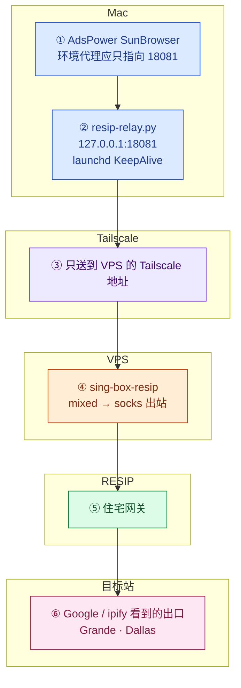

# AdsPower 住宅出口 IP 变 `---`：句柄耗尽、系统代理叠层与验收标准

> 适用场景：AdsPower 环境（文中叫 `resip-dallas`）本来应走本机 `127.0.0.1:18081` 住宅链，结果页面转圈、代理检测显示 `---`，或 Google 打不开。底层链路按 [从零把 Claude 接到美国静态住宅 IP](./residential-proxy-vps-relay.md) 已经搭过，这篇只讲 **2026-11-01 这一夜怎么一步步排、哪里判错、最后怎么改成直连 18081**。
>
> ✅ **状态：已在浏览器里实测通过（2026-11-01 → 2026-11-02）**。SunBrowser 能打开 Google 搜索页，`api.ipify.org` 正文是 `<住宅出口IP>`（Grande / AS7459 / Dallas）。验收时 **没有** 打开 Claude；**没有** 依赖 v2rayN 的 TUN。

::: tip 和「搭链路」那篇怎么分工
搭法、买什么、端口含义、日常健康检查，看 [住宅代理中转](./residential-proxy-vps-relay.md)。本文是故障复盘：假阳性、文件句柄耗尽、ToolMerge 临时绕路、AdsPower「系统代理」内存态、以及「只有 curl 通不算修好」。
:::

::: danger 公开笔记里不要留下的东西
RESIP 账密、AdsPower login-token、邮箱、Cookie、完整卡号，都不进这篇。地址只用占位符：`<VPS公网IP>`、`<VPS的Tailscale IP>`、`<住宅出口IP>`、`<国内真实IPv4>`。可以写运营商和城市（Grande / Dallas）、端口 `10808` / `18081` / `18082`。本机路径用 `~`。
:::

[[toc]]

## 1. 目标与验收标准（先钉死，再动手）

这一夜要达成的，不是「中继进程还活着」，而是：

| 项 | 要求 |
|---|---|
| 谁 | AdsPower 里专门给住宅号用的那个环境（`resip-dallas`） |
| 怎么走 | 本机 `127.0.0.1:18081` → Tailscale → VPS `sing-box-resip` → RESIP |
| 目标站看到 | `<住宅出口IP>`，Grande，Dallas |
| 测什么 | **只在 SunBrowser 里**打开 Google，且打开 `https://api.ipify.org` |
| 算通过 | Google 页有真实搜索框（不是 chrome-error），ipify **正文**等于 `<住宅出口IP>` |
| 明确不做 | 不为了测网去打开 `claude.ai`；不以 `curl -x ...` 单独宣布修好 |

记一句：**curl 通只证明中继/出口通，不等于 AdsPower 的 ProxyChain 通。** 标题里出现 `www.google.com` 也不够——chrome-error 页的标题也可以长得很像。

## 2. 链路长什么样（排障时心里要有这张图）



旁边还有两件**不在实线上**、却最容易把排障带偏的东西：

1. **v2rayN 的 `10808`**：日常系统代理/SOCKS 入口。AdsPower 一旦「跟随系统代理」，会把 `http://127.0.0.1:10808` **叠在**环境代理前面。
2. **v2rayN 的 TUN**：虚拟网卡截 IPv4。本夜最终形态下，AdsPower **不依赖** TUN；日常科学上网可以继续靠 TUN，但那是另一条路。

## 3. 现象：IP 变 `---`，Google 代理失败

作者侧当时的表象大致是：

- AdsPower 代理检测 / 环境信息里 IP 变成 `---`
- SunBrowser 打开 Google 失败，CDP 里能看到 `ERR_PROXY_CONNECTION_FAILED`（后来叠错层时还出现过 `ERR_TUNNEL_CONNECTION_FAILED` / `ERR_EMPTY_RESPONSE`）
- 用户反馈「最近几天都没用过 AdsPower，怎么会撑爆」——这句很关键，后面第 5 节会解释

同一晚还踩过一次**假阳性**：只看了页面 title 里有 `www.google.com`，就以为修好了。CDP 再看，其实是 chrome-error 页。**标题匹配 ≠ 真打开了 Google。**

## 4. 分析顺序（按实际走过的路径）

```text
浏览器里 Google / ipify 不过
        │
        ▼
curl -x http://127.0.0.1:18081 → ipify？
        │
     否 ┴ 是（本夜多数时候先卡在「否」）
     │     │
     ▼     ▼
 先修中继   再看 AdsPower 是否叠了 10808
 （§5）     （§6 → §7）
```

原则：

1. 先让 `18081` 自己能稳定接连接（否则后面改 AdsPower 都是空转）。
2. 中继通了，再用 **CDP / 截图** 看 SunBrowser 的真实导航结果，不要用 curl 代替。
3. 若 SunBrowser 日志或 `lsof` 里出现 `10808`，按「系统代理叠层」处理，不要先去改 RESIP 账密。

## 5. 根因一：`resip-relay` 文件句柄耗尽（Errno 24）

### 5.1 证据

`~/Library/Logs/resip/` 下的错误日志（当时备份过一份 `relay.err.bak-*`）里大量：

- `OSError: [Errno 24] Too many open files`
- `socket.accept() out of system resource`

表现放大到浏览器：本机 `18081` 接不住 → SunBrowser `ERR_PROXY_CONNECTION_FAILED`。

### 5.2 为什么「几天没用 AdsPower」也会爆

这和「最近有没有开 AdsPower」**没有必然关系**。

- LaunchAgent `com.xiaohai.resip-relay` 是 **KeepAlive + RunAtLoad**：中继进程一直在跑。
- macOS 上该进程当时的 **soft `RLIMIT_NOFILE` 大约只有 256**。
- 历史连接若没有两端都关干净，或有短连接风暴 / 健康检查 / 其它本机客户端打 `18081`，文件描述符会慢慢堆到上限。

所以用户「最近几天没用」完全说得通：进程一直在、上限过低、关闭不彻底，就够爆。

### 5.3 改法

| 项 | 做法 |
|---|---|
| 脚本 | `~/.local/bin/resip-relay.py`：提高自身 NOFILE；用有界并发（Semaphore）；管道两端在 `finally` 里必关 |
| LaunchAgent | plist 里 `SoftResourceLimits` / `HardResourceLimits` 的 `NumberOfFiles` 提到 `65536`；保持 KeepAlive / RunAtLoad；stdout/err 落到 `~/Library/Logs/resip/` |
| 重载 | `bootout` 后再 `bootstrap`，确认 `lsof` 仍听在 `127.0.0.1:18081` |

辅证可以再跑一次：

```bash
curl -x http://127.0.0.1:18081 --connect-timeout 10 --max-time 25 https://api.ipify.org
echo
```

应返回 `<住宅出口IP>`。**这一步只能证明中继活了，不能宣布 AdsPower 好了。**

## 6. 根因二：AdsPower 把系统代理 `10808` 叠进 ProxyChain

### 6.1 机制（AdsPower 8.9.23 附近）

SunBrowser（Canvas）往往不是简单吃一条 `--proxy-server`，而是吃 StaticConfig 里的 **ProxyChain**。

当全局「系统代理」为开时，AdsPower 会把**启动时缓存到的** macOS 系统代理（作者机上常见是 v2rayN 留下的 `http://127.0.0.1:10808`）**放在环境代理前面**。日志里会出现类似：

```text
[ProxyCheck] 系统代理：开
```

于是链条变成：

```text
[{http 127.0.0.1:10808}, {http|socks 你在环境里填的代理}]
```

`10808` 若仍是 v2ray 的 SOCKS 语义、却被当成 HTTP 去连，或当时根本没人在听，就会 `ERR_PROXY_CONNECTION_FAILED`。若强行再叠一跳「本意是修，结果变成双跳」，还会变成隧道失败 / 空响应。

搭建篇 [§7.1 / §7.3](./residential-proxy-vps-relay.md) 已经写过「启动时读一次系统代理」；本夜又确认了一层细节：

> **磁盘上的 conf 已经是 `system_proxy=0`，不等于正在跑的进程内存里也是 0。** 改库不重启主程序，日志仍可能报「系统代理：开」。

### 6.2 本夜走过的弯路：ToolMerge 顶住 10808

为了先让浏览器通，临时用 gost 系的 ToolMerge 做了两路本地转发：

| 端口 | 作用（临时） |
|---|---|
| `10808` | HTTP → `127.0.0.1:18081`，专门「接住」AdsPower 注入的系统代理跳 |
| `18082` | SOCKS5 → `18081`，顺手给 v2rayN 加一个可选手动节点 |

环境一度设成 `proxy_soft=no_proxy`，让 ProxyChain **只剩**被注入的那一跳 `10808`，再由 ToolMerge 接到 `18081`。这样 **CDP 实测 Google + ipify 曾经通过**，但留下两个结构性问题：

1. **和 v2rayN 抢 `10808`**：日常若恢复「系统代理占用 10808」，两边冲突。
2. **依赖 TUN 的观感**：当时用户问「用 AdsPower 是不是一定要开 TUN」——在 ToolMerge 占着 10808 的过渡形态下，关 TUN、改回系统代理确实容易把链搞断；这不是住宅链路天生要 TUN，是端口被占带来的副作用。
3. **重启后是否还在**：临时 LaunchAgent / 手工拉起不够干净。

所以过渡方案算「通了」，不算「收干净」。用户要求立刻改，不要拖到第二天——接下来做了最终形态。

## 7. 最终形态：环境直连 `18081`，不再靠 10808 / TUN

### 7.1 改动清单

| 项 | 结果 |
|---|---|
| 环境代理 | Local API 把该环境改成 **HTTP `127.0.0.1:18081`**（不要再叠 multi-level / 系统 10808） |
| AdsPower 主程序 | **完全退出再开**，让内存里的 `system_proxy=0` 生效 |
| ToolMerge `10808` | LaunchAgent bootout，plist 挪走禁用；**10808 还给 v2rayN** |
| ToolMerge `18082` | 可保留作备用 SOCKS→18081，非必须 |
| v2rayN 节点 | 增加/改成 HTTP 节点指向 `127.0.0.1:18081`（ConfigType 按客户端版本选 HTTP），方便像 `.83` / `.40` 一样手动切住宅；**不改变**你当前正在用的业务节点，除非你自己点切换 |
| IPv6 | 物理网卡保持关，避免绕开代理泄露真实地址（见搭建篇 §5.5 / §7.5） |

### 7.2 改配置时的诚实记录：有一段「裸奔」

改到一半时，曾经有大约四分钟，环境处在**不走代理**的状态。AdsPower 自己的 IP 检测拿到了 `<国内真实IPv4>`（合肥侧），还把环境地区/时区一度改成中国 / `Asia/Shanghai`。切回 `18081` 后，地区与时区已改回 Dallas / `America/Chicago`。

那段时间**没有**打开 Claude，但暴露是改法顺序造成的：**应该先锁好出口再启动环境。** 这是本夜必须写进纪律的一条。

### 7.3 浏览器验收（唯一算数的证据）

用 CDP 看真实页面，而不是看 title 字符串：

| 检查 | 通过标准 |
|---|---|
| Google | `title` 正常、页面上有搜索框、没有 `ERR_` |
| ipify | 导航到 `https://api.ipify.org`，**响应正文**精确等于 `<住宅出口IP>` |
| 依赖关系 | 验收当时 **v2rayN 核心未运行**（无 xray/sing-box 业务进程），默认路由走物理网卡，也未开系统代理 → **证明不依赖 TUN** |
| `lsof` | SunBrowser 的 TCP 应指向 `127.0.0.1:18081`，不应再出现业务意义上的 `10808` 叠层 |

辅助命令示例：

```bash
lsof -nP -iTCP | grep -i sunbrowser
```

## 8. 端口与职责（收干净之后）

| 端口 | 谁听 | 给谁用 |
|---|---|---|
| `18081` | `resip-relay`（LaunchAgent） | AdsPower 住宅环境、桌面 Claude、以及 v2rayN 里可选的 `resip-dallas` HTTP 节点 |
| `18082` | 可选 ToolMerge SOCKS→18081 | 备用，可删 |
| `10808` | **留给 v2rayN** | 日常系统代理；**不要**再让 AdsPower 的「系统代理」开关把它叠进住宅链 |
| `18080` | 机房专线（`sing-box-ts`） | Chrome Claude Login 等机房出口场景，与本文无关 |

## 9. 以后怎么用、怎么验

### 9.1 AdsPower

1. 设置里的 **「系统代理」保持关**。改过之后若主程序一直没退出过，先 Cmd+Q 再开。
2. 环境代理只填 `127.0.0.1:18081`（HTTP 或 SOCKS 按你 VPS mixed 入站能力选；作者侧用 HTTP）。
3. 不要再开「多级代理」去叠 `10808`。
4. 打开环境前，先确认中继在听：`lsof -nP -iTCP:18081 -sTCP:LISTEN`。
5. **先锁出口，再启动环境。** 不要在代理栏空着或指向错误端口时让 AdsPower 跑自检。

### 9.2 v2rayN

- 日常节点（`.83` / `.40` 等）与 TUN / 系统代理模式，按你自己的习惯；**AdsPower 住宅链不再绑死「必须开 TUN」**。
- 若数据库里加过 `resip-dallas` 节点，需要 **退出并重开 v2rayN UI** 才能看到；这只影响手动切换，不影响 AdsPower 直连 `18081`。
- 不要把住宅做成全局默认出口去刷日常流量（额度与身份都会脏），理由见搭建篇 §10.2。

### 9.3 验收口令（对着念）

1. 中继：`curl -x http://127.0.0.1:18081` → `<住宅出口IP>`（辅证）
2. SunBrowser：Google 有搜索框
3. SunBrowser：ipify 正文 = `<住宅出口IP>`
4. `lsof`：SunBrowser → `18081`，没有错误的 `10808` 叠层
5. 以上都过，才许说「好了」

## 10. 教训清单（给下次的自己）

1. **永远不要只用 curl 宣布应用层修好。** 应用里（这里是 SunBrowser）Google + ipify 才算数。
2. **title 像 Google ≠ Google。** 用 CDP 看有没有搜索框、有没有 `ERR_`。
3. **KeepAlive 中继 + 过低 NOFILE + 连接没关干净 = 会在「你没用的日子」爆掉。** 查 `~/Library/Logs/resip/`，不要先怪业务软件。
4. **AdsPower 的系统代理开关以进程内存为准。** 改 conf / 关开关后必须重启主程序；日志里的「系统代理：开」比库字段更可信。
5. **临时 ToolMerge 顶端口能救急，不能当终态。** 终态应是环境直连 `18081`，`10808` 还给日常 VPN。
6. **改代理配置时先锁出口再开浏览器。** 中间态裸奔会污染指纹地区/时区。
7. **测网不要打开 Claude。** 少一次无关登录面，少一次风控噪声。
8. **IPv6 保持关**（在 TUN 仍不管 IPv6 的前提下），避免真实地址旁路。

## 11. 和本站其它文的关系

| 文档 | 角色 |
|---|---|
| [从零把 Claude 接到美国静态住宅 IP](./residential-proxy-vps-relay.md) | 链路怎么搭、日常检查、IPv6、加购端口 |
| [Claude 专线全记录](./claude-wireguard-vpn.md) | `18080` 机房专线与桌面历史方案 |
| [Claude 桌面版 Try again](./claude-desktop-try-again.md) | Electron / Cloudflare 白屏，和「代理链不通」不是同一类病 |
| 本文 | AdsPower 住宅环境从 `---` 到直连 `18081` 的排障与验收纪律 |

更新于 2026-11-02（Asia/Shanghai）。事实来源是 2026-11-01 当晚的中继日志、AdsPower 代理日志、CDP 截图与配置变更记录；公开稿已去掉账密、token 与真实地址数字。
