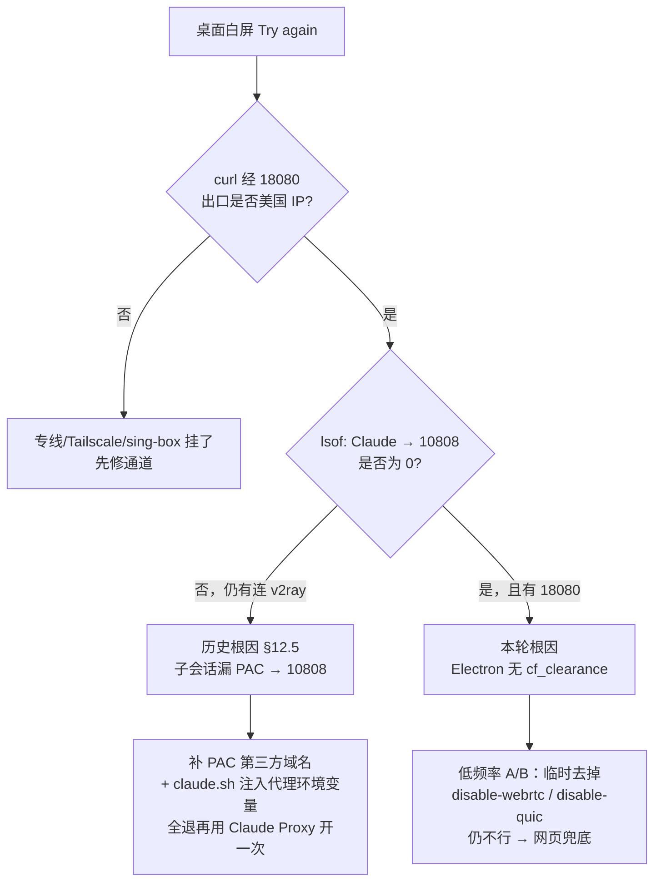

# Claude 桌面版白屏「Can't reach / Try again」：两轮根因、诊断与低频率修复

> 适用场景：Mac 上 Claude Desktop 打开后白屏，提示 `Can't reach Claude. Check your connection.` / `Try again`；网页版（同代理）却能正常打开。
>
> ✅ **状态：已沉淀（2026-10-25）**。本文把「封号前多次修好」的那一轮，和「今晚代理明明通却仍白屏」的这一轮，放在一起对比；给出可复用的诊断顺序、操作过程、禁项和应急方案。
>
> 前置阅读：[Claude 专线全记录：WireGuard → VLESS → Tailscale](./claude-wireguard-vpn.md)（尤其第 12 节与 12.5 节 PAC 补丁）。本文不重复搭专线，只讲 **桌面壳层连不上** 时怎么查、怎么修。

---

## 1. 现象长什么样

典型画面：

- 桌面窗口整页白底，中间一行：`Can't reach Claude`
- 副文：`Check your connection.` + 蓝色按钮 `Try again`
- 点 `Try again` 往往没用；从 Dock / 启动台再开一次也一样

容易误判的两点：

1. **以为代理挂了**——其实用同一条 Tailscale HTTP 代理（例如 `http://100.124.51.126:18080`）去 `curl`，出口仍是美国 IP（例如 `34.3.96.83`），网页 Chrome Claude Login 同代理也能打开登录页。
2. **以为账号又被封了**——封禁页文案通常是 Organization disabled / Usage Policy，和「连不上」不是同一张皮。

一句话先立住：**出口 IP 正常 ≠ 桌面 Electron 已经过完 Cloudflare。**

---

## 2. 两轮根因对比（一定要先分清你卡在哪一轮）



### 2.1 封号前的历史根因（§12.5，2026-10-23 实测）

**表象**：Raycast「Claude Proxy」已经带了 `--proxy-server=…:18080`，主页面看起来在走专线，却仍偶尔白屏；关掉本机 v2ray 后更明显。

**机制**：

| 流量 | 实际走哪 |
|---|---|
| 主页面 / 主会话 | `--proxy-server` → Tailscale `…:18080` |
| hCaptcha、Cloudflare challenge、stripe、sentry、statsig、intercom、segment 等 | 读 **系统 PAC**，旧 PAC 没命中 → 落到 `127.0.0.1:10808`（v2ray） |

v2ray 一抖或一关，这些人机验证 / 统计请求失败，桌面就跟着白屏。

**已验证有效的修法**（细节见专线教程 12.5）：

1. `~/claude-proxy.pac` 把上述第三方域名也指到 `18080`（**故意不加 Google**）
2. `claude.sh` 注入 `HTTP_PROXY` / `HTTPS_PROXY=…18080`
3. **完全退出**后只用 Raycast「Claude Proxy」/`claude.sh` 重开（Dock 无效）
4. 用 `lsof` 验证：Claude → `10808` 条数为 **0**，→ `18080` 应有连接

### 2.2 本轮根因（2026-10-25）：Electron 过不了 Cloudflare

**表象**：PAC 已是 §12.5 那套，`lsof` 也显示 `10808=0`、出口 IP 正确，网页同代理能开，桌面仍白屏。

**机制**（简化）：

- 桌面是 Electron；主视图（mainView）要过 Cloudflare 挑战，才能拿到可用的 `cf_clearance`
- 本轮桌面 Cookie 里往往只有 `__cf_bm`，**没有** `cf_clearance`
- 挑战过不去 → 壳层一直「Can't reach」——**不是** HTTP 代理进程挂死

和历史根因的关键差别：

| | 历史（§12.5） | 本轮（Electron / CF） |
|---|---|---|
| 出口 IP | 可能偶发不对（漏 10808） | 通常一直正确 |
| `lsof` → 10808 | 非 0 | 应为 0 |
| 网页同代理 | 可能也抖 | **可用** |
| Cookie 特征 | 不强调 | 有 `__cf_bm`、无 `cf_clearance` |

先跑一遍 `lsof` 再下结论，避免把两轮问题混着治。

---

## 3. 诊断顺序（先读数，再动手）

下面命令在 Mac 上跑；把 `<VPS_TS_IP>` 换成你的 Tailscale 内网 IP（文档里常见是 `100.124.51.126`）。

### 3.1 专线是否真的通

```bash
# 经 HTTP 代理看出口（应是美国 IP，例如 34.3.96.83）
curl -x http://<VPS_TS_IP>:18080 -sS --max-time 15 https://api.ipify.org
echo

# Tailscale 节点是否在线
tailscale status | head
```

不通 → 先查 Tailscale 登录、VPS 上 `sing-box-ts` / 反代是否活着；**不要**先去折腾桌面 Cookie。

### 3.2 进程是不是带代理启动的

```bash
# 应能看到 --proxy-server=http://<VPS_TS_IP>:18080
# 以及（若你启用了加固）--disable-webrtc --disable-quic
ps eww -o pid,command -p "$(pgrep -f '/Applications/Claude.app' | head -1)" | tr ' ' '\n' | grep -E 'proxy-server|PROXY|disable-webrtc|disable-quic' || true
```

没有 `--proxy-server` → 多半是 Dock / 启动台 / 更新后自启，**立刻退出**，改用 Raycast「Claude Proxy」。

### 3.3 有没有漏到本机 v2ray（历史根因检查）

```bash
# 应为 0 行
lsof -nP -iTCP -sTCP:ESTABLISHED 2>/dev/null | grep -i claude | grep 10808 || echo "OK: no 10808 leak"

# 应有连到 18080 的行
lsof -nP -iTCP -sTCP:ESTABLISHED 2>/dev/null | grep -i claude | grep 18080 || echo "WARN: no 18080 yet"
```

`10808` 非 0 → 回到 §12.5：查 PAC 域名列表、系统「自动代理配置」是否仍指向 `~/claude-proxy.pac`、`claude.sh` 是否注入了环境变量。

### 3.4 Cookie / CF 状态（本轮根因检查）

桌面数据目录大致在：

```text
~/Library/Application Support/Claude/
```

本轮观察到的模式：挑战相关 Cookie 只有 `__cf_bm`，缺少 `cf_clearance`。  
**不要**从 Chrome 把 `cf_clearance` 拷进桌面——实测会被丢掉，白做且增加噪声。

---

## 4. 操作过程（低频率，忌狂启狂点）

> 风控提醒：短时间反复退出 / 重开 / 狂点 `Try again`，会在同一出口 IP 上留下密集失败指纹。  
> **一轮诊断 → 至多一次有目的的重开 → 停下来观察。** 不要把「再试一次」当成默认循环。

### 4.1 标准修复（多数时候够用）

1. **确认** 3.1–3.3 都健康（出口对、`10808=0`、进程带 proxy）。
2. **完全退出** Claude（菜单 Quit，或确认无残留进程）。
3. **只开一次**：Raycast 搜「Claude Proxy」或跑你的 `claude.sh`。  
   - ❌ Dock、启动台、`open -a Claude`
   - ❌ 点白屏上的 `Try again` 连点十几下
4. 等 30–60 秒看主视图是否从白屏变成登录页 / 会话页。  
   网页侧若卡在 Cloudflare「Just a moment」，也可以多等一会儿或手动刷新一次（对桌面不一定适用，但同出口下网页先通是好信号）。

### 4.2 A/B 一次：临时去掉 `--disable-webrtc` / `--disable-quic`

10/23 附近成功 boot 的配置，有时**只有** `--proxy-server`，没有后面两项加固。  
加固是为了防真 IP 经 WebRTC/QUIC 泄漏，**不是** Cloudflare 解法；但个别环境下它们可能干扰 Electron 拿 clearance。

做法：

1. **先备份** `claude.sh`（带日期后缀）。
2. 临时注释或删掉启动参数里的 `--disable-webrtc`、`--disable-quic`，**保留** `--proxy-server`。
3. 全退 → **只开一次** Claude Proxy。
4. 若仍白屏：**立刻还原**备份，不要叠更多实验参数。

### 4.3 网页兜底（今天就能干活）

同代理下的 **Chrome Claude Login** 独立 profile 往往能过 CF。流程建议：

1. 用专用启动脚本打开该 profile（带同一 `18080` 代理）。
2. 登录选 **Continue with email**，不要点 Continue with Google（若该 profile 曾登过个人 Google，SSO 可能绑回旧组织）。
3. 邮箱里的魔法链接：**复制 URL，粘贴进同一个 Claude Login 窗口**；不要在邮件客户端里直接点开（容易进日常浏览器、丢代理）。

桌面修好之前，用网页继续任务完全合理。

### 4.4 再往上：住宅出口（需你点头）

AdsPower / 美区住宅 IP 是验证过不去时的可选下一步，**不是**桌面已验证成功的标准补丁。要换出口前先确认：会不会和现有专线指纹策略冲突、是否接受成本。

---

## 5. 明确无效 / 不要再空转的做法

| 做法 | 结果 |
|---|---|
| 从 Chrome 拷 `cf_clearance` 进桌面 Cookie | 会被丢掉 |
| 给桌面加 `--remote-debugging-port` | App 拒绝 |
| 把 `--proxy-server` 直接指到 VLESS 端口（如 `:38480`） | 那不是 HTTP 代理，壳层用不了 |
| Dock / 启动台 / 更新后自启 | 丢掉 `--proxy-server`，流量可能改走 10808 |
| 短时间脚本循环 `kill` + relaunch「验证是否修好」 | 容易把刚恢复的会话杀掉，并增加监控噪声 |
| `StopSubagent all` 之类的全局停助手 | 会误停其它助手挂着的活（如 Apple 订阅改档） |

---

## 6. 应急清单（按优先级）

1. **代理挂了**：`tailscale status`、VPS 上反代 / `sing-box-ts`、本机能否 `curl -x …:18080`。
2. **进程没带 proxy**：Quit → 只用 Claude Proxy 开一次。
3. **漏 10808**：按 §12.5 修 PAC + 环境变量，再验证 `lsof`。
4. **10808=0 仍白屏**：A/B 一次去掉 webrtc/quic；失败立刻还原。
5. **还不行**：网页 Chrome Claude Login 兜底；住宅出口等你确认后再动。
6. **备用通道**：文档里的 VLESS Reality（公网端口）可作为系统级备用，但**不要**未经确认就改成桌面的 `--proxy-server`。

---

## 7. 修好之后：别再为「验证」杀一次

本轮真实教训：

- 桌面好不容易过了 CF / 能用，排查脚本或「再确认一遍」又把进程退掉 → 用户侧看起来像「刚修好你又退出了」。
- 规则：**用户说好了就停手**。需要留证时，用只读命令（`ps` / `lsof` / `curl`），不要 relaunch。
- 自动化 watch（防更新丢代理）可以留着纠偏；**人工排查窗口**里关掉「自动杀启」。

---

## 8. 和账号、旧数据的边界（避免踩第二颗雷）

- **封禁组织的云端聊天**，不能指望新号桌面一键官方接管。
- 本机 Claude Code 的 `~/.claude/projects/**/*.jsonl` 可以**只读导出**摘要，在新号会话里粘贴续写；不要把旧号 session / 指纹写回新 profile。
- 独立 Login profile 里若曾 Google 登录过个人号，点「Continue with Google」可能绑回旧组织——桌面与网页都优先 **Continue with email**。

---

## 9. 最小检查表（下次白屏先打勾）

- [ ] `curl -x http://<VPS_TS_IP>:18080 https://api.ipify.org` 是预期美国 IP  
- [ ] 进程命令行含 `--proxy-server=…18080`  
- [ ] `lsof`：Claude → `10808` = 0；→ `18080` 有连接  
- [ ] 本轮只全退 + Claude Proxy **开过一次**，没有连点 Try again  
- [ ] 若做了 A/B：已备份，失败已还原  
- [ ] 需要干活时网页兜底可用；不把旧 Cookie / Google SSO 当捷径  

---

## 10. 延伸阅读

- [Claude 专线全记录](./claude-wireguard-vpn.md) — 搭 Tailscale 内网代理、§12.5 PAC 补全第三方域名  
- [Claude 多账号切换且不丢会话](./claude-multi-account-switch.md) — Desktop / Code 切号与侧边栏索引  

---

*记录于 2026-10-25。文中 IP/端口为作者自用专线的技术说明；私钥、完整 Cookie、邮箱密码不会写进公开教程。若你的环境变量名、PAC 路径不同，以本机实际配置为准，诊断顺序不变。*
