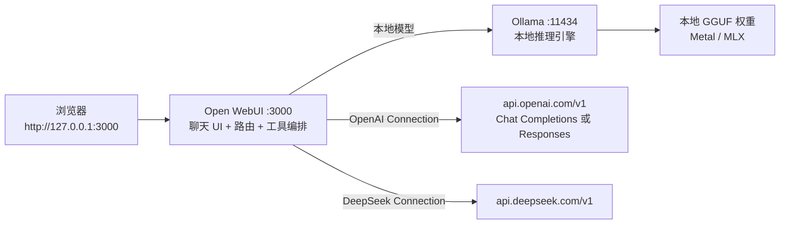
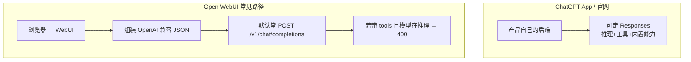

# Apple Silicon Mac 本地大模型搭建指南（Ollama + Open WebUI）

> 基于 2026-10-18 在 **Mac mini M4 / 24GB**（用户：小海兄）上的真实安装，并于 **2026-10-24** 按现网踩坑重写原理章。  
> 适用于任意 **Apple Silicon（M 系列）且内存 ≥ 16GB** 的 Mac。  
> 目标：从 **0→1** 讲清「谁在干什么、请求怎么走」，再给出可复现的 **安装 → 拉模型 → Web 对话 → 自启动 → 自测**；不是只会点按钮。

---

## 0. 读前先建立心智模型（必读）

很多人跟着助手点来点去会懵，不是你笨，是界面把三层东西叠在一起了：

| 层 | 是什么 | 你该怎么想 |
|---|---|---|
| **推理引擎** | Ollama | 本机真正「跑模型」的服务，类似本地小服务器 |
| **聊天前端 + 路由** | Open WebUI | 浏览器 UI；把你的话转发给 Ollama **或** 云端 API |
| **模型 / 连接** | 下拉框里的名字 | 有的是本地权重标签（如 `qwen2.5:7b`），有的是云端 Connection 扫出来的（如 `gpt-5-mini`） |

**一句话：**  
浏览器只跟 Open WebUI 说话；Open WebUI 再决定去问本机 Ollama，还是去问 `api.openai.com` / DeepSeek 等。  
**ChatGPT App / 官网** 走 OpenAI 自家完整链路（可走新接口）；**Open WebUI** 多数时候按「OpenAI 兼容」转发，默认常走老的 Chat Completions——这就是后面 `gpt-5.6-luna` 报错的根。

日常建议：**本地用 `qwen2.5:7b` / `deepseek-r1:8b`；云端用已验证可用的 `gpt-5-mini` 等。`gpt-5.6-luna` 先弃用**（原因见 §4）。

---

## 1. 目标与架构

### 1.1 要搭成什么样

| 能力 | 说明 |
|---|---|
| 本地推理 | 本机跑 7B/8B 量化模型，对话数据默认不出本机 |
| 网页聊天 | 浏览器打开 `http://127.0.0.1:3000` |
| 开机自启 | 登录后 Ollama + Open WebUI 自动起来 |
| 写代码调用 | OpenAI 兼容：`http://127.0.0.1:11434/v1` |
| 可选云端 | WebUI 里接 DeepSeek / OpenAI 等，与本地模型并排对比 |

### 1.2 架构图（本机、无 Docker）



| 组件 | 端口 / 路径 | 本机参考版本 | 安装方式 |
|---|---|---|---|
| Ollama | `11434` | 0.40.0 | Homebrew |
| 模型 | `~/.ollama/models` | `qwen2.5:7b`、`deepseek-r1:8b`（及 `*-16k`） | `ollama pull` / ModelScope |
| Open WebUI | `3000`（绑定 `127.0.0.1`） | 0.12.3 | `uv tool install`（Python 3.12） |
| LaunchAgent | `com.xiaohai.open-webui` | — | `~/Library/LaunchAgents/` |
| WebUI 数据 | `~/local-llm/open-webui-data/` | — | `DATA_DIR` |
| uv | — | 0.9.21 | Homebrew |

**为什么不用 Docker？**  
国内拉 `ghcr.io` / Docker Hub 上的 Open WebUI 镜像往往极慢或失败；本机实测用 **uv + 清华 PyPI** 更稳。本文按「无 Docker」写死。

### 1.3 五个名词：别混

| 名词 | 干什么 | 常见误解 |
|---|---|---|
| **Ollama** | 加载权重、跑推理、暴露 `/api` 与 `/v1` | 它不是「聊天网页」 |
| **Open WebUI** | 登录、历史、多模型对比、接云端、挂工具 | 它不是「模型本身」；停掉它本地 `ollama run` 仍可用 |
| **模型（Model）** | 一组权重 + 模板，如 `qwen2.5:7b` | 云端列表里的名字是「远端模型 ID」，权重不在你家硬盘 |
| **连接（Connection）** | Admin → Connections 里一条 Base URL + API Key | 连上不等于每个远端模型都能在 WebUI 里随便开工具+推理 |
| **Workspace 自定义模型** | 在 WebUI 里给已有模型套人设、默认参数、绑工具 | 改的是「配置层」，不下载新权重 |

---

## 2. OpenAI 兼容两条路：Completions vs Responses（原理）

OpenAI 现在有两套「聊天式」HTTP 接口（都挂在 `https://api.openai.com` 下）：

| | **Chat Completions** | **Responses** |
|---|---|---|
| 路径 | `POST /v1/chat/completions` | `POST /v1/responses` |
| 地位 | 老标准，生态最广；仍支持 | 新推荐；Agent / 内置工具 / 推理+工具更完整 |
| 入参习惯 | `messages` + 顶层 `reasoning_effort` | `input` + 嵌套 `reasoning.effort` |
| 工具 | 自定义 function tools；**从 GPT-5.4 起**：若 `reasoning_effort` **不是** `none`，**禁止**再带 function tools | 推理与工具可一起用；还有 web_search 等内置工具 |
| 谁在用 | 大量第三方客户端、**Open WebUI 默认转发路径** | ChatGPT App / 官网新能力、官方推荐新项目 |

官方说明（迁移与限制）：

- [Migrate to the Responses API](https://developers.openai.com/api/docs/guides/migrate-to-responses)  
  > Starting with GPT-5.4, Chat Completions does not support tool calling with `reasoning_effort` values other than `none`.
- [Reasoning models](https://developers.openai.com/api/docs/guides/reasoning)
- Azure 侧同款限制说明：[Work with chat completion models](https://learn.microsoft.com/en-us/azure/foundry/openai/how-to/chatgpt)

**何时用哪条（实用结论）：**

- **只聊天、不要工具、要兼容老 SDK** → Completions 通常够用（如本机已验证的 `gpt-5-mini`）。
- **要「边想边调工具」或用内置搜索等** → 必须 Responses（或 Completions 且把 `reasoning_effort` 设成 `none`——但许多推理模型默认就在推理）。
- **Open WebUI 0.12.x 聊天页** → 多数请求仍按 Completions 形状往外发；即便 Connection 里能选 Responses，参数映射也容易踩坑（见 §4、§14）。

### 2.1 `reasoning_effort` 是什么

对「会思考」的模型（o 系列、GPT-5.x 推理档等），API 用 **`reasoning_effort`（Completions）** 或 **`reasoning.effort`（Responses）** 告诉模型「想多少」：常见取值如 `none` / `minimal` / `low` / `medium` / `high` …（**不是每个模型都支持全部取值**）。

- 越高：更慢、更贵、通常更稳。  
- `none`：尽量不推理，偏低延迟。  
- **有的模型默认就会推理**；你在 UI 里没选，请求里仍可能带上非空 effort。

### 2.2 Open WebUI 里的 Function Calling：`default` / `native` / `Legacy`

聊天 Controls → **Function Calling**（本机 0.12.3 实测只有这三个，**没有「关」**）：

| 选项 | 含义（结合官方文档） |
|---|---|
| **native** | 走模型原生 function calling（结构化 tool_calls）。自较新版本起这是推荐默认；系统工具、Agent 能力也绑在这条路上。 |
| **Legacy**（旧名曾叫 Default） | 用长提示词「教」模型输出伪工具格式；已标明不支持、不修新功能。 |
| **default** | 界面遗留选项：实际常落成「跟全局/模型默认走」，在较新版语义上往往等于 native 或未显式指定。 |

官方工具模式说明：[Tools / Open WebUI](https://docs.openwebui.com/features/extensibility/plugin/tools/)

要点：**只要 Function Calling 不是彻底关闭，WebUI 就可能在请求里带上 `tools`。** 本版 Controls **没有「关闭工具」**，Reasoning Effort **也没有 `none`**——所以你无法在界面上凑出「Completions + tools + reasoning_effort=none」这一组合。

### 2.3 为何 Completions + tools + 非空 reasoning 会互斥

简化因果链：

1. OpenAI 规定：从 GPT-5.4 起，**`/v1/chat/completions` 不允许「function tools + 非 `none` 的 reasoning_effort」**。  
2. 像 `gpt-5.6-luna` 这类档位，**默认就在推理**（或不接受「无推理」），于是一带 tools 就 400。  
3. 报错大意通常是：  
   `Function tools with reasoning_effort are not supported in /v1/chat/completions. To use function tools, use /v1/responses or set reasoning_effort to 'none'.`  
4. Open WebUI 若仍打 Completions，又自动带 tools，且 UI 给不出 `none` → **界面解不了，不是你点错。**

社区相关讨论（参数映射 / Responses 迁移）：

- [open-webui#28418](https://github.com/open-webui/open-webui/issues/28418)（Completions→Responses 时 `reasoning_effort` 需处理）  
- [Discussion #28421](https://github.com/open-webui/open-webui/discussions/28421)

### 2.4 ChatGPT App / 官网 vs Open WebUI：路径差在哪



| | ChatGPT App | Open WebUI（本机接官方 API） |
|---|---|---|
| 谁拼请求 | OpenAI 产品后端 | 你的 WebUI 进程 |
| 接口 | 产品侧可走 Responses 全能力 | 兼容层；聊天默认常 Completions |
| 工具 + 强推理模型 | 产品内已对齐 | 易撞上官方互斥规则 |
| 你能改的 | 很少 | Connection、Controls、是否新开聊天 |

所以：**同一模型名在 App 里能聊，在 WebUI 里报错，并不矛盾。**

### 2.5 「旧聊天」会绑死模型 / 参数

Open WebUI 的**每一条聊天**会记住当时的模型与一批参数（含 Function Calling、Reasoning Effort 等）。  
你在 Admin 或全局改了设置，**旧会话不一定全跟着变**。

**实操：** 改 Connection / Controls 后，用 **「+ 新聊天」** 再测；别在一条已经报错过的旧线程里反复点。

---

## 3. 硬件要求

| 项目 | 最低 | 推荐（本文参考机） |
|---|---|---|
| 芯片 | Apple Silicon（M1 及以上） | M4 |
| 内存 | **16GB** | **24GB**（跑 7B/8B Q4 较从容） |
| 磁盘空闲 | ≥ 20GB | ≥ 30GB |
| 系统 | macOS 13+ | arm64，非 Rosetta |

**内存经验：**

- 7B / 8B **Q4_K_M**：约 **5–6GB**，24GB 很舒服。  
- 14B Q4：约 9GB。  
- 32B：能加载但挤；入门别首选。  
- 超大开源权重不可能在 24GB 本机跑，只能走 API。

---

## 4. 踩坑专节：云端推理模型 + 工具调用（`gpt-5.6-luna` 案例）

### 4.1 现象（本机 2026-10-24）

- 已在 Open WebUI 接入 `https://api.openai.com/v1`；**`gpt-5-mini` 可用**。  
- 选用 **`gpt-5.6-luna`** 发消息 → 报错，大意：Chat Completions 下不能同时开 **Function Tools** 与 **非空 `reasoning_effort`**。  
- Controls 实测：**Function Calling** 只有 `default` / `native` / `Legacy`；**Reasoning Effort 没有 `none`**。  
- 结论：**靠这版 UI 关不掉互斥 → luna 先弃用**；日常用 `gpt-5-mini` 等已验证模型。

### 4.2 根因（对应 §2）

不是 Key 错了，也不是「模型下架」，而是：

1. WebUI 往 **`/v1/chat/completions`** 发请求；  
2. 又带上 **tools**（Function Calling 开着）；  
3. luna 属于需要 / 默认带推理 effort 的档；  
4. OpenAI 拒绝该组合。

### 4.3 现在怎么做（务实）

| 做法 | 说明 |
|---|---|
| **弃用 luna（推荐）** | 下拉框选 `gpt-5-mini` 或本地模型；需要强推理时用官方 App，或等 WebUI 对 Responses 映射成熟 |
| 新开聊天再测 | 避免旧会话绑死参数 |
| 不要为了「点通」乱关全局安全项 | 原理在 §2；乱改不如换模型 |
| 自己写代码 | 用官方 SDK 打 **Responses**，或 Completions 且显式 `reasoning_effort: "none"`（若该模型允许） |

**不鼓励**在当前 Open WebUI 0.12.3 上继续折腾 luna「一定要点绿」。

---

## 5. 环境准备

以下在 **本机 Terminal（zsh）** 执行。路径以 Apple Silicon Homebrew 前缀 `/opt/homebrew` 为准。

### 5.1 确认芯片与内存

```bash
uname -m                    # 应为 arm64
sysctl -n machdep.cpu.brand_string
sysctl -n hw.memsize | awk '{print $1/1024/1024/1024 " GB"}'
```

### 5.2 安装 / 配置 Homebrew（中国大陆建议 USTC 镜像）

```bash
/bin/bash -c "$(curl -fsSL https://raw.githubusercontent.com/Homebrew/install/HEAD/install.sh)"
echo 'eval "$(/opt/homebrew/bin/brew shellenv)"' >> ~/.zprofile
eval "$(/opt/homebrew/bin/brew shellenv)"
```

```bash
export HOMEBREW_API_DOMAIN="https://mirrors.ustc.edu.cn/homebrew-bottles/api"
export HOMEBREW_BOTTLE_DOMAIN="https://mirrors.ustc.edu.cn/homebrew-bottles"
export HOMEBREW_BREW_GIT_REMOTE="https://mirrors.ustc.edu.cn/brew.git"
export HOMEBREW_CORE_GIT_REMOTE="https://mirrors.ustc.edu.cn/homebrew-core.git"
brew update
```

> 镜像以 [USTC Homebrew 帮助](https://mirrors.ustc.edu.cn/help/brew.git.html) 为准。

### 5.3 安装 uv

```bash
brew install uv
uv --version   # 本机参考：0.9.21
mkdir -p ~/.local/bin
echo 'export PATH="$HOME/.local/bin:$PATH"' >> ~/.zshrc
export PATH="$HOME/.local/bin:$PATH"
```

### 5.4 工作目录

```bash
mkdir -p ~/local-llm/{modelfiles,logs,models,open-webui-data}
```

| 路径 | 用途 |
|---|---|
| `~/local-llm/modelfiles/` | Modelfile |
| `~/local-llm/logs/` | Open WebUI 日志 |
| `~/local-llm/open-webui-data/` | WebUI 数据库、上传、向量库 |
| `~/local-llm/models/` | 可选：本地 RAG 向量模型 |
| `~/.ollama/models` | Ollama 权重（自动管理） |

---

## 6. 安装 Ollama

### 6.1 Homebrew 安装并自启

```bash
brew install ollama
brew services start ollama
ollama --version          # 本机参考：0.40.0
curl http://127.0.0.1:11434
# 应返回：Ollama is running
```

- LaunchAgent：`~/Library/LaunchAgents/sh.brew.ollama.plist`  
- 日志：`/opt/homebrew/var/log/ollama.log`

```bash
brew services restart ollama
tail -f /opt/homebrew/var/log/ollama.log
```

### 6.2 （可选）性能环境变量

可在 brew 服务 plist 的 `EnvironmentVariables` 中加：

| 变量 | 示例 | 作用 |
|---|---|---|
| `OLLAMA_FLASH_ATTENTION` | `1` | Flash Attention |
| `OLLAMA_KV_CACHE_TYPE` | `q8_0` | KV cache 量化 |

改完后 `brew services restart ollama`。

---

## 7. 拉取模型

### 7.1 官方源（能通就优先）

```bash
ollama pull qwen2.5:7b
ollama pull deepseek-r1:8b
ollama list
```

### 7.2 官方源过慢 → ModelScope（实测）

注意：只适合**单文件 GGUF**；拉下的模型有时缺对话模板，需 Modelfile 套官方 TEMPLATE。

```bash
ollama pull modelscope.cn/lmstudio-community/Qwen2.5-7B-Instruct-GGUF:Q4_K_M
ollama pull modelscope.cn/unsloth/DeepSeek-R1-0528-Qwen3-8B-GGUF:Q4_K_M
```

**`~/local-llm/modelfiles/Modelfile.qwen2.5-7b`（结构示意）：**

```dockerfile
FROM modelscope.cn/lmstudio-community/Qwen2.5-7B-Instruct-GGUF:Q4_K_M
# 粘贴官方 qwen2.5 的 TEMPLATE / SYSTEM / stop
SYSTEM """You are Qwen, created by Alibaba Cloud. You are a helpful assistant."""
PARAMETER stop "<|im_start|>"
PARAMETER stop "<|im_end|>"
```

**`~/local-llm/modelfiles/Modelfile.deepseek-r1-8b`（结构示意）：**

```dockerfile
FROM modelscope.cn/unsloth/DeepSeek-R1-0528-Qwen3-8B-GGUF:Q4_K_M
PARAMETER temperature 0.6
PARAMETER top_p 0.95
```

```bash
ollama create qwen2.5:7b -f ~/local-llm/modelfiles/Modelfile.qwen2.5-7b
ollama create deepseek-r1:8b -f ~/local-llm/modelfiles/Modelfile.deepseek-r1-8b
```

### 7.3 命令行冒烟（脚本必须加 `</dev/null`）

```bash
ollama run qwen2.5:7b "用一句话介绍一下合肥。" </dev/null
ollama run deepseek-r1:8b --hidethinking "9.11 和 9.9 哪个大？只给结论。" </dev/null
```

缺 `</dev/null` 时，`ollama run` 会一直等 stdin，看起来像卡住。  
本机约 **21 tokens/s**（7B/8B Q4，视机型略有出入）。`9.11` vs `9.9` 结论应为 **9.9 更大**。

---

## 8. 安装 Open WebUI（uv，不用 Docker）

### 8.1 清华 PyPI

```bash
export UV_INDEX_URL="https://pypi.tuna.tsinghua.edu.cn/simple"
uv tool install open-webui --python 3.12
which open-webui    # ~/.local/bin/open-webui
open-webui --version  # 本机参考：0.12.3
```

虚拟环境约在 `~/.local/share/uv/tools/open-webui`（约 2GB）。

### 8.2 预置 RAG 向量模型（强烈建议）

首次开知识库可能去 HuggingFace 拉 `all-MiniLM-L6-v2`，国内易卡住。预置到 `~/local-llm/models/all-MiniLM-L6-v2`，并在启动环境中：

| 变量 | 值 |
|---|---|
| `RAG_EMBEDDING_MODEL` | `/Users/<你的用户名>/local-llm/models/all-MiniLM-L6-v2` |
| `RAG_EMBEDDING_MODEL_AUTO_UPDATE` | `false` |
| `RAG_RERANKING_MODEL_AUTO_UPDATE` | `false` |
| `HF_ENDPOINT` | `https://hf-mirror.com` |

### 8.3 前台试跑

```bash
export DATA_DIR="$HOME/local-llm/open-webui-data"
export OLLAMA_BASE_URL="http://127.0.0.1:11434"
export HF_ENDPOINT="https://hf-mirror.com"
export HF_HUB_DISABLE_XET=1
open-webui serve --host 127.0.0.1 --port 3000
```

```bash
curl -o /dev/null -s -w '%{http_code}\n' http://127.0.0.1:3000
# 期望：200
```

浏览器打开 <http://127.0.0.1:3000>，确认后 `Ctrl+C`，再配自启动。

---

## 9. 自启动（launchd）

### 9.1 Ollama

由 `brew services start ollama` 管理即可。

### 9.2 Open WebUI：`com.xiaohai.open-webui`

创建 `~/Library/LaunchAgents/com.xiaohai.open-webui.plist`（**把 `/Users/xiaohaixiong` 换成你家目录**）：

```xml
<?xml version="1.0" encoding="UTF-8"?>
<!DOCTYPE plist PUBLIC "-//Apple//DTD PLIST 1.0//EN" "http://www.apple.com/DTDs/PropertyList-1.0.dtd">
<plist version="1.0">
<dict>
	<key>EnvironmentVariables</key>
	<dict>
		<key>DATA_DIR</key>
		<string>/Users/xiaohaixiong/local-llm/open-webui-data</string>
		<key>HF_ENDPOINT</key>
		<string>https://hf-mirror.com</string>
		<key>HF_HUB_DISABLE_XET</key>
		<string>1</string>
		<key>OLLAMA_BASE_URL</key>
		<string>http://127.0.0.1:11434</string>
		<key>PATH</key>
		<string>/Users/xiaohaixiong/.local/bin:/opt/homebrew/bin:/usr/bin:/bin:/usr/sbin:/sbin</string>
		<key>RAG_EMBEDDING_MODEL</key>
		<string>/Users/xiaohaixiong/local-llm/models/all-MiniLM-L6-v2</string>
		<key>RAG_EMBEDDING_MODEL_AUTO_UPDATE</key>
		<string>false</string>
		<key>RAG_RERANKING_MODEL_AUTO_UPDATE</key>
		<string>false</string>
	</dict>
	<key>KeepAlive</key>
	<true/>
	<key>Label</key>
	<string>com.xiaohai.open-webui</string>
	<key>ProgramArguments</key>
	<array>
		<string>/Users/xiaohaixiong/.local/bin/open-webui</string>
		<string>serve</string>
		<string>--host</string>
		<string>127.0.0.1</string>
		<string>--port</string>
		<string>3000</string>
	</array>
	<key>RunAtLoad</key>
	<true/>
	<key>StandardErrorPath</key>
	<string>/Users/xiaohaixiong/local-llm/logs/open-webui.err.log</string>
	<key>StandardOutPath</key>
	<string>/Users/xiaohaixiong/local-llm/logs/open-webui.out.log</string>
	<key>WorkingDirectory</key>
	<string>/Users/xiaohaixiong/local-llm/open-webui-data</string>
</dict>
</plist>
```

```bash
launchctl bootstrap gui/$(id -u) ~/Library/LaunchAgents/com.xiaohai.open-webui.plist
launchctl kickstart -k gui/$(id -u)/com.xiaohai.open-webui
launchctl print gui/$(id -u)/com.xiaohai.open-webui | grep state
curl -o /dev/null -s -w '%{http_code}\n' http://127.0.0.1:3000
```

停本次：`launchctl bootout gui/$(id -u)/com.xiaohai.open-webui`  
日志：`tail -f ~/local-llm/logs/open-webui.err.log`

---

## 10. 首次注册与管理员

1. 打开 <http://127.0.0.1:3000>  
2. **第一个注册账号即管理员**（可不验证邮箱）  
3. 模型下拉应能看到本地 `qwen2.5:7b`、`deepseek-r1:8b`（及 `*-16k`）  
4. 可「+」多模型并排对比  

数据在 `~/local-llm/open-webui-data/`（含 `webui.db`）。删目录 = 清空账号与历史。

---

## 11. 接入 DeepSeek / OpenAI 等云端

路径：头像 → **Admin Panel → Settings → Connections** → Manage OpenAI API Connections → ➕ Add Connection。

**切勿把真实 API Key 写进文档、截图发群或提交 Git。** Key 只填在 WebUI 里。

### 11.1 DeepSeek

| 项 | 值 |
|---|---|
| URL | `https://api.deepseek.com/v1` |
| API Key | [platform.deepseek.com](https://platform.deepseek.com) 创建 |

### 11.2 OpenAI（本机已验证）

| 项 | 值 |
|---|---|
| URL | `https://api.openai.com/v1` |
| API Key | OpenAI 控制台创建（本文一律写 `sk-...` 占位） |
| 日常模型 | **`gpt-5-mini`（推荐）**；**不要优先选 `gpt-5.6-luna`**（见 §4） |

连接文档：[Connect a provider](https://docs.openwebui.com/getting-started/quick-start/connect-a-provider/)

### 11.3 本地 OpenAI 兼容 API（给代码用）

| 项 | 值 |
|---|---|
| Base URL | `http://127.0.0.1:11434/v1` |
| API Key | 任意，如 `ollama`（本地不校验） |

```bash
curl http://127.0.0.1:11434/v1/models
curl http://127.0.0.1:11434/v1/chat/completions \
  -H 'Content-Type: application/json' \
  -d '{"model":"qwen2.5:7b","messages":[{"role":"user","content":"Reply with exactly: pong"}]}'
```

```python
from openai import OpenAI
client = OpenAI(base_url="http://127.0.0.1:11434/v1", api_key="ollama")
r = client.chat.completions.create(
    model="qwen2.5:7b",
    messages=[{"role": "user", "content": "你好"}],
)
print(r.choices[0].message.content)
```

---

## 12. 自测闭环

### 12.1 服务存活

```bash
curl -s http://127.0.0.1:11434
curl -o /dev/null -s -w '%{http_code}\n' http://127.0.0.1:3000
ollama list
ollama ps
```

### 12.2 命令行 / HTTP / 网页

```bash
ollama run qwen2.5:7b "用一句话介绍一下合肥。" </dev/null
```

网页：登录 → 选本地模型发「你好」→ 再选 `gpt-5-mini`（若已配 Key）发一句短问题。  
**测云端新模型务必新开聊天。**

### 12.3 对比题库（可选）

同一题分别问本地与云端：微服务比喻、英语改错、Java LRU、HashMap 并发、订单超时方案、三开关三灯、9.11 vs 9.9、长文总结（需 §13 的 16k）、工具规划 JSON 等。评分看准确性、胡编、语感、能否编译、速度。

---

## 13. 上下文超限（4096 → `*-16k`）

Ollama 许多模型默认 `num_ctx=4096`，长文易爆。

```bash
cat > ~/local-llm/modelfiles/Modelfile.qwen2.5-7b-16k << 'EOF'
FROM qwen2.5:7b
PARAMETER num_ctx 16384
EOF
cat > ~/local-llm/modelfiles/Modelfile.deepseek-r1-8b-16k << 'EOF'
FROM deepseek-r1:8b
PARAMETER num_ctx 16384
EOF
ollama create qwen2.5:7b-16k -f ~/local-llm/modelfiles/Modelfile.qwen2.5-7b-16k
ollama create deepseek-r1:8b-16k -f ~/local-llm/modelfiles/Modelfile.deepseek-r1-8b-16k
```

`num_ctx` 越大越吃内存；24GB 上 16k 对 7B/8B Q4 通常可接受。

---

## 14. 启停与资源释放

| 组件 | 启动 | 停止 | 查状态 |
|---|---|---|---|
| Ollama | `brew services start ollama` | `brew services stop ollama` | `curl 127.0.0.1:11434` |
| Open WebUI | `launchctl bootstrap gui/$(id -u) ~/Library/LaunchAgents/com.xiaohai.open-webui.plist` | `launchctl bootout gui/$(id -u)/com.xiaohai.open-webui` | `curl …:3000` |
| 已加载模型 | 网页点模型 / `ollama run` | `ollama stop <名>` | `ollama ps` |

**四个层级（从轻到重）：**  
L1 只 `ollama stop`（日常首选）→ L2 停 Ollama 服务 → L3 停 WebUI → L4 挪走 LaunchAgent plist 取消自启。

可选脚本 `~/local-llm/llm-start.sh` / `llm-stop.sh`（内容与旧版相同思路：start 拉起并 curl 自检，stop 卸载模型并停服务）。

本机磁盘量级约 **11–13GB**（模型 ~9GB + WebUI 环境 ~2GB + 缓存）。

---

## 15. 常见问题（FAQ）

| 现象 | 原因与处理 |
|---|---|
| `gpt-5.6-luna` 报 tools + reasoning 互斥 | 见 **§2、§4**；换 `gpt-5-mini` / 本地模型；新开聊天 |
| Controls 没有 Reasoning `none` | 本版 UI 限制；不是你漏点 |
| Function Calling 关不掉 | 只有 default/native/Legacy；关不了就别用会撞规则的远端推理模型 |
| App 里能用、WebUI 报错 | 路径不同：App 可走 Responses；WebUI 常走 Completions |
| 改了设置旧聊天仍报错 | 旧会话绑参数；**新开聊天** |
| `ollama run` 脚本卡住 | 加 `</dev/null` |
| `brew` / `ollama pull` 慢 | USTC / ModelScope（§5、§7） |
| Docker 拉 WebUI 失败 | 改用本文 uv 路径 |
| WebUI 启动卡下载 | 预置向量模型 + `RAG_*_AUTO_UPDATE=false` |
| 长文上下文不够 | 建 `*-16k`（§13） |
| 内存高 / 风扇转 | `ollama ps`；停多余模型；降 `num_ctx` |

### 15.1 卸载摘要

```bash
ollama rm qwen2.5:7b deepseek-r1:8b qwen2.5:7b-16k deepseek-r1:8b-16k 2>/dev/null
launchctl bootout gui/$(id -u)/com.xiaohai.open-webui 2>/dev/null || true
rm -f ~/Library/LaunchAgents/com.xiaohai.open-webui.plist
uv tool uninstall open-webui
# 会删账号与记录：# rm -rf ~/local-llm/open-webui-data
brew services stop ollama && brew uninstall ollama && rm -rf ~/.ollama
```

---

## 16. 延伸阅读

| 资源 | 链接 |
|---|---|
| Ollama | https://ollama.com · https://github.com/ollama/ollama · https://ollama.com/library |
| Open WebUI 文档 | https://docs.openwebui.com |
| Open WebUI 连接 Provider | https://docs.openwebui.com/getting-started/quick-start/connect-a-provider/ |
| Open WebUI Tools（Native vs Legacy） | https://docs.openwebui.com/features/extensibility/plugin/tools/ |
| OpenAI：迁移到 Responses | https://developers.openai.com/api/docs/guides/migrate-to-responses |
| OpenAI：Reasoning | https://developers.openai.com/api/docs/guides/reasoning |
| OpenAI：Function calling | https://developers.openai.com/api/docs/guides/function-calling |
| WebUI issue：reasoning_effort / Responses | https://github.com/open-webui/open-webui/issues/28418 |
| WebUI discussion：Responses 参数映射 | https://github.com/open-webui/open-webui/discussions/28421 |
| DeepSeek API | https://api-docs.deepseek.com/ |
| ModelScope | https://www.modelscope.cn |
| USTC Homebrew / 清华 PyPI | https://mirrors.ustc.edu.cn/help/brew.git.html · https://mirrors.tuna.tsinghua.edu.cn/help/pypi/ |
| uv | https://docs.astral.sh/uv/ |
| HF 镜像 | https://hf-mirror.com |

---

## 附录 A. 本机路径速查

| 项 | 路径 |
|---|---|
| 使用说明笔记 | `~/local-llm/README-使用说明.md` |
| Modelfile | `~/local-llm/modelfiles/` |
| Open WebUI 数据 | `~/local-llm/open-webui-data/` |
| Open WebUI 日志 | `~/local-llm/logs/open-webui.*.log` |
| Ollama LaunchAgent | `~/Library/LaunchAgents/sh.brew.ollama.plist` |
| Open WebUI LaunchAgent | `~/Library/LaunchAgents/com.xiaohai.open-webui.plist` |
| Ollama 日志 | `/opt/homebrew/var/log/ollama.log` |
| 模型权重 | `~/.ollama/models` |

## 附录 B. 给「跟着文档执行的 AI」的检查清单

1. `uname -m` = `arm64`，内存 ≥ 16GB  
2. `brew`、`uv`、`ollama`、`open-webui` 在 PATH  
3. `curl 127.0.0.1:11434` → `Ollama is running`  
4. `ollama list` 含目标模型；长文另有 `*-16k`  
5. `curl` 3000 → `200`；LaunchAgent label 为 `com.xiaohai.open-webui`  
6. 脚本里 `ollama run` 均带 `</dev/null`  
7. 未使用 Docker；国内镜像已按需配置  
8. **未把真实 API Key 写入文档或仓库**；云端 Key 仅存在 WebUI Connections  
9. 文档已写明：luna 类模型与 tools+reasoning 互斥；日常推荐 `gpt-5-mini` / 本地模型  

---

*安装过程据 2026-10-18；原理与 luna 踩坑据 2026-10-24 现网与官方文档整理。组件升级后以官方文档为准微调。*
