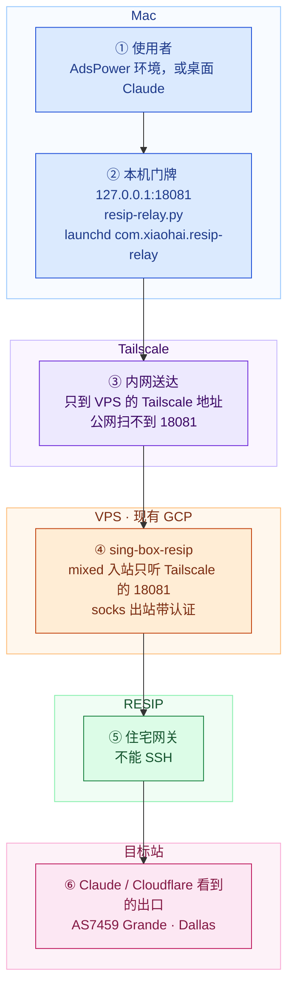
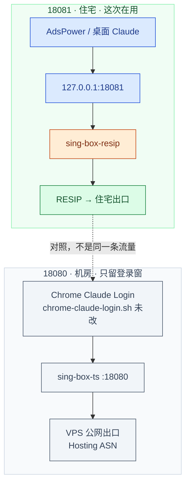
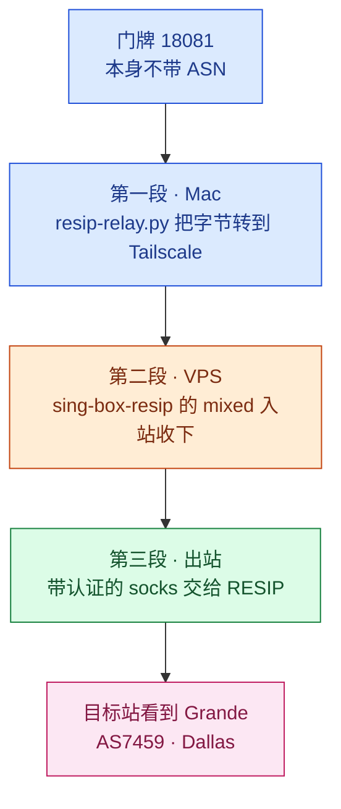
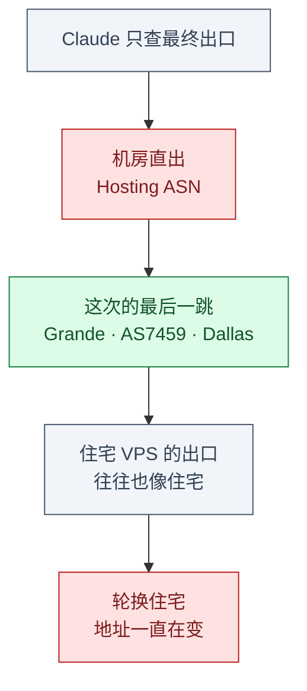
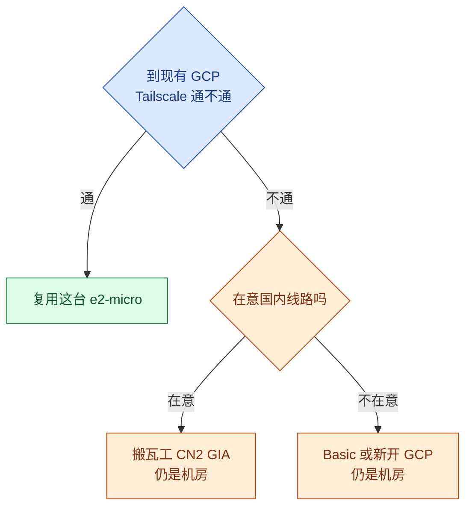
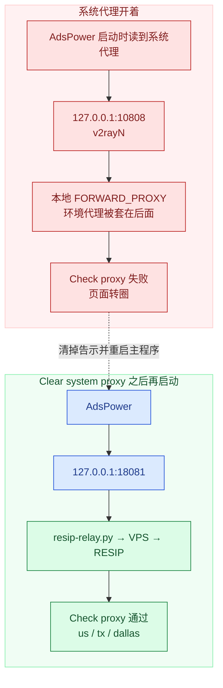
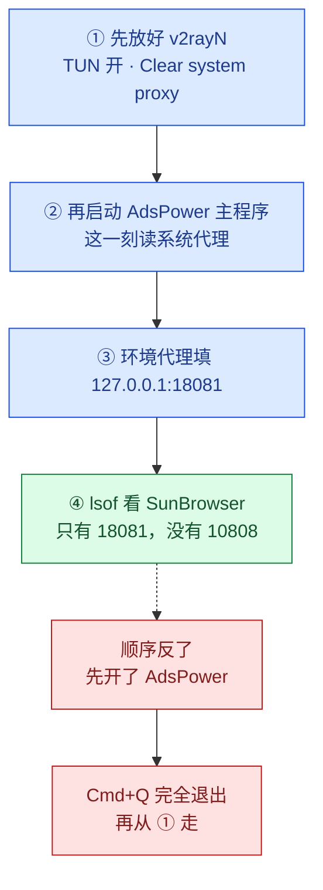
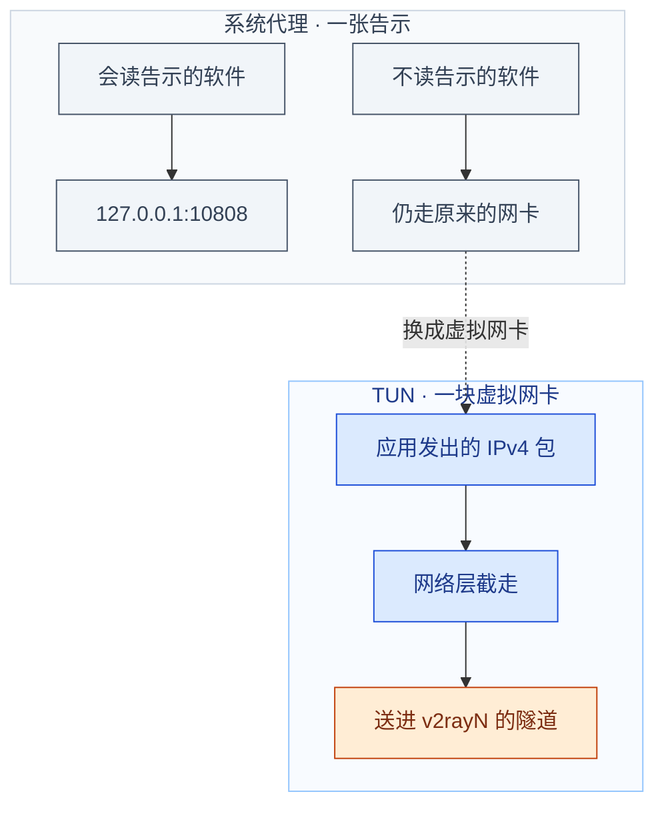
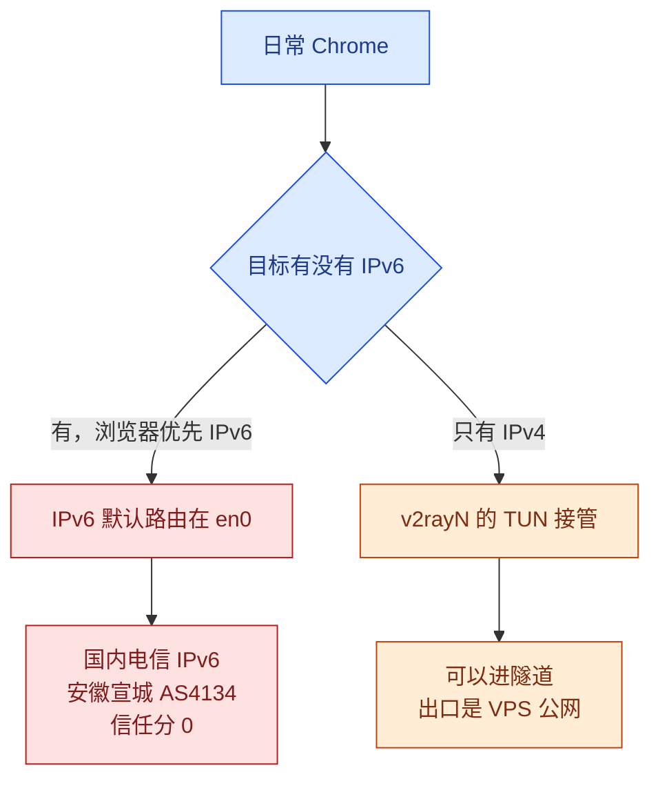
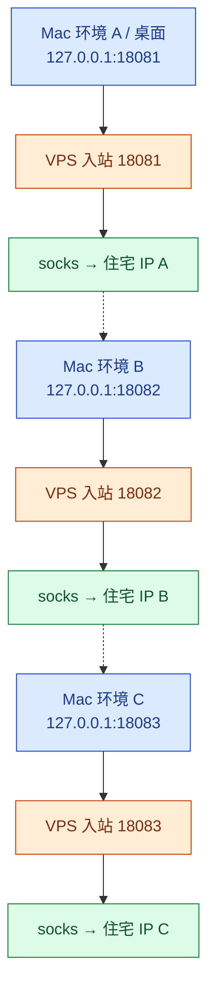

# 从零把 Claude 接到美国静态住宅 IP

Claude 和前面的 Cloudflare 不看你买了几台机器，只查**连到他们的那一个出口 IP 挂在哪家运营商**。这个归属叫 ASN。查到 Google Cloud 这类托管商，就是机房；查到 Grande 这种住宅宽带商，才像一户家庭。

这篇按从 0 到 1 来写：先讲清要解决的问题，给出整条链路，把该买和不该买的一次对比完，然后是每一步在哪台机器、哪个软件里填什么、看到什么算对。最后是今天实际踩过的坑、新号怎么注册、以及以后加 IP 和回滚。

专线本身（Tailscale、`sing-box-ts`、端口 `18080`）已经在跑，搭法见 [Claude 专线全记录](./claude-wireguard-vpn.md)。桌面曾经白屏，见 [Claude 桌面版 Try again](./claude-desktop-try-again.md)。那篇负责壳层；**从 2026-10-26 起，桌面的出口改到本文的 `18081`。**

::: tip 状态（2026-10-26）
AdsPower 里的 Claude，和桌面 Claude，都走 Mac 上的 `127.0.0.1:18081`。本机 `resip-relay.py`（launchd：`com.xiaohai.resip-relay`）经 Tailscale 送到 VPS 的 `sing-box-resip`，再进 RESIP。目标站看到的是美国静态住宅：Grande，AS7459，Dallas。流量额度 50GB/月。

`18080` 还在，只留给 Chrome 的 Claude Login，出口仍是 VPS 公网 `<VPS公网IP>`（机房）。v2rayN 保持 Enable Tun，系统代理保持 Clear。Wi-Fi 和 Ethernet 的 IPv6 保持关闭。
:::

::: danger 公开笔记里不要留下的东西
RESIP 的用户名和口令、邮箱、魔法链接、Cookie、完整卡号，都不进这篇。地址只用三个占位符：`<VPS公网IP>`、`<VPS的Tailscale IP>`、`<住宅出口IP>`。可以写的只有运营商和城市（AS7459 Grande，Dallas）、端口 `10808` / `18080` / `18081`、公开卡段 `454924`。不写 GCP 项目名。本机路径用 `~`。
:::

[[toc]]

## 1. 问题与目标

### 1.1 机房出口会让 Claude 看到什么

现有中转是一台 GCP e2-micro，区域 us-west1。上面的 `sing-box-ts` 监听 `<VPS的Tailscale IP>:18080`，出站是这台机器自己的公网。Claude 因此看到一个 Hosting ASN。

这个出口能把流量送出大陆，桌面版却经常停在 Cloudflare 的 `Can't reach Claude` / `Try again`。账号已经在 AdsPower 的住宅环境里注册、登录，桌面若仍从机房出去，网页和桌面就不是同一张脸。

所以要换的不是「再买一台能 SSH 的电脑」，而是**最后一跳的 ASN**。

### 1.2 做完之后应该是什么样

| 谁 | 填哪里 | 目标站看到的出口 |
|---|---|---|
| AdsPower 里的 Claude 环境 | `127.0.0.1:18081` | `<住宅出口IP>`，Grande，Dallas |
| 桌面 Claude | `claude.sh` 指向 `http://127.0.0.1:18081` | 同一个 `<住宅出口IP>` |
| Chrome Claude Login | 原脚本不动，仍走 `18080` | `<VPS公网IP>`，机房 |
| 日常 Chrome（v2rayN 的 TUN） | 不填 `18081` | 境外站点是 `<VPS公网IP>`；绕过大陆的国内站点仍是中国 IPv4 |

四种商品（机房 IP、静态住宅代理、住宅 VPS、轮换住宅）和两台候选中转（这台 GCP、搬瓦工）的差别在第 3 节一次说完。第 2 节先看数据包实际怎么走。

## 2. 全局原理

### 2.1 住宅链路长什么样

色块按机器分组。手机上图是竖着排的，每一块标题里都有机器名，不依赖辨色。



| 图上的编号 | 机器 | 这一步你做什么 |
|---|---|---|
| ① | Mac | 只在 AdsPower 或桌面 Claude 里使用，第 5.4、5.6 节 |
| ② | Mac | 本机转发进程，第 5.2 节 |
| ③ | Tailscale | 专线那篇已经通了，这次不重建 |
| ④ | VPS | 新服务 `sing-box-resip`，第 5.1 节 |
| ⑤ | RESIP | 用户名和口令只写在 VPS 的出站里 |
| ⑥ | 目标站 | 用来验证，不用配置 |

旁边还有两件不在这条实线上、但会影响你看检测站的设置：第 5.3 节的 v2rayN（Clear system proxy，TUN 开着），第 5.5 节关掉 IPv6。

### 2.2 18080 还留着做什么



两个 systemd 服务互不影响。停掉 `sing-box-resip`，`sing-box-ts` 还在。Chrome 登录窗仍显示机房 IP 时，不代表住宅链路坏了，它本来就没改。

### 2.3 为什么填 18081 就走住宅

端口只是门牌。`18080` 和 `18081` 都开在同一台 VPS 的 Tailscale 地址上，差别是门后面接的出站。



三段都在，填 `127.0.0.1:18081` 的程序才会从住宅出去：

1. **Mac 本地转发。** `127.0.0.1:18081` 上的进程只搬字节，直连 `<VPS的Tailscale IP>:18081`。它不读系统代理，也不保存 RESIP 的账密。
2. **VPS 上的 sing-box-resip。** mixed 入站认 HTTP 代理和 SOCKS。出站是一条带认证的 socks，指向 RESIP 网关。
3. **RESIP 网关。** 流量从 Grande 的地址出去。Claude 只能看见这一跳。

`18080` 的门后面是 `direct`，所以还是机房。把桌面或 AdsPower 指到 `18081`，换的是门牌后面的三段，不是「18081 这个数字天生是住宅」。

## 3. 方案一次对比完

### 3.1 四种出口

| 商品 | 你买到的 | 这次 |
|---|---|---|
| 机房 IP（现有 GCP，或搬瓦工） | 能 SSH 的托管机器。ASN 是 Hosting | 只拿来中转，不拿它的公网见 Claude |
| 静态住宅代理 | 一个尽量固定的 HTTP / SOCKS 网关账号。不能登录 | **用。** RESIP Pro，美国，Grande / AS7459，Dallas，50GB/月 |
| 住宅 VPS | 能 SSH，出口 ASN 往往像住宅 | 不买 |
| 轮换 / 动态住宅 | 出口在地址池里换，同一个人不会一直住在同一段地址 | 不买。账号需要的是稳定的一户家庭，不是每次换门牌 |

静态的意思是：出口尽量停在这一段住宅地址上。它仍然只是账号，没有磁盘，不能在那头装 sing-box。

轮换适合「每次请求换一个访问者」。拿来养一个长期登录的 Claude，站点看到的家庭一直在搬家。



### 3.2 选定 RESIP，以及没选的两样

| 选项 | 结论 | 理由 |
|---|---|---|
| RESIP Pro 美国静态住宅 | 用 | 出口是住宅 ISP，城市在 Dallas，额度 50GB/月，正好接在已有 VPS 后面 |
| 住宅 VPS | 不买 | 贵，货源不稳，供应商参差。标题写着住宅，不代表 ASN 真是住宅。它解决的是「那头有 shell」，AdsPower 和这条 sing-box 都不需要 |
| Proxy-Seller | 不选 | 地址是池化的，多人共用、会换。选购时的用户反馈里还有 DNS 泄露：网页走了代理，域名解析却从另一条网络出去，真实地区仍然暴露 |

住宅 VPS 还有一层和「贵」无关的限制：机器若在境外，从大陆直接连它上面的代理协议，一样会被 GFW 干扰。最后往往还是要一台机房中转，变成两台机器。现在的拆法更轻：已有 GCP 负责把流量送出大陆，RESIP 只提供最后一跳的身份。

判断标准和 Claude 一样。看 `ip.net.coffee` 和 browserleaks 上的最终 ASN，不看商品标题。

### 3.3 中转放在哪台机器

中转问的是「从家里能不能稳定摸到一台境外机器」，不是「ASN 像不像住宅」。



| 机器 | 适合做什么 | 这次 |
|---|---|---|
| 已有 GCP e2-micro，us-west1 | 上面已经有 Tailscale、`18080`、桌面 Claude 的启动链。复用成本是再加一个服务 | **就用它** |
| 从零再开一台 GCP | 又一台 Hosting。国内直连美国云主机并不稳，Tailscale 或代理协议还得重新送出去 | 不新开 |
| 搬瓦工 Basic | 便宜的 KVM 机房。官网对 Basic 的说法是本地对等、部分机房有成本向的中国对等，不是 CN2 GIA | 不为这次买 |
| 搬瓦工里写了 CN2 GIA 的美国机房 | 卖点是国内更容易摸到这台机器。ASN 仍是 Hosting，替代不了 RESIP | 只有「手头没有一条已经通的中转」时才看 |

::: details 标价备忘（会变，结账以购物车为准）
搬瓦工数字来自 **2026-10-25** 的官网目录 [catalog.json](https://bandwagonhost.com/order/catalog.json)，单位是该账期的美元总价。当时这些档有货。

- Basic 20G：**49.99 美元/年**。1 GB 内存，2 vCPU，20 GB 盘，每月 1 TB，1 Gbps。机房包括洛杉矶 USCA_2、弗里蒙特、纽约 USNY_6，可在 Basic 机房之间迁移。
- E-Commerce 20G，且机房说明里有 CN2 GIA：**49.99 美元/季，89.99 美元/半年，169.99 美元/年**。1 GB 内存，2 vCPU，20 GB 盘，每月 1 TB，2.5 Gbps。机房包括洛杉矶 USCA_6、USCA_9，圣何塞 USCA_SJC5，纽约 USNY_8。同名 E-Commerce 也有不带 CN2 的机房，不能只看档名。这些机房的说明写了电信 CN2 GIA、移动 CMIN2、联通 Premium。
- 洛杉矶 USCA_5 的 E-Commerce+SLA，20G 年付 239.99 美元（季付 65.89 美元），说明里同样有 CN2 GIA，还带 SLA。仍然是机房 IP。

GCP 没有为这次新开机器，所以没有「本次成交价」。从零购买的公开目录价（[economize.cloud 的 e2-micro 表](https://www.economize.cloud/resources/gcp/pricing/compute-engine/e2-micro/)，us-central1，按需，2026-10-24，730 小时，不含税、不含磁盘、外部 IP 和出流量）：e2-micro 约 **6.11 美元/月**，e2-small 约 **12.23 美元/月**。官方价目以 [VM instance pricing](https://cloud.google.com/products/compute/pricing) 为准。

[Google Cloud Free](https://cloud.google.com/free) 在指定的三个美国区域提供一台 e2-micro 的实例时长，外加有限的磁盘和很小的出流量额度。中转的出流量很容易超出免费额度，而且免费档不解决国内直连。不要为了「免费」再开一台来替代已经通的 Tailscale。
:::

### 3.4 为什么大陆不能直连 RESIP

RESIP 标注中国大陆需要中转。国内机器直接去连境外代理协议，会被 GFW 干扰。住宅账号不能拿来当「从家里一把梭出去」的那一跳。

没有 VPS 时只剩两条路，这次都没走：换一个标明支持国内直连的住宅产品，或者用机场节点串住宅。家里到这台 GCP 的 Tailscale 已经通，就让 VPS 去连 RESIP。VPS 在境外，这一跳不再穿过 GFW。

| 段 | 谁来做 | 解决什么 |
|---|---|---|
| Mac → Tailscale → GCP | 已有机房 VPS | 把流量平安送出大陆 |
| GCP → RESIP → 目标站 | 住宅代理 | 出去之后像一户 Dallas 的家庭 |

### 3.5 在 VPS 上用 sing-box

住宅这一跳用 sing-box，不开 3x-ui。理由就这四条，和这台机器上已经在跑的 `sing-box-ts` 对齐：

| | sing-box | 3x-ui |
|---|---|---|
| 形态 | 一个配置文件，加一个 systemd 服务 | 带 Web 面板的管理套件 |
| 和现有栈 | 与 `sing-box-ts` 同一个二进制、同一套习惯 | 再引入一套面板 |
| 暴露面 | 没有为了改配置再开一个网站入口。`18081` 只听 Tailscale 地址 | 面板本身是一块要保管的入口 |
| 这次 | **用** | 不用 |

入站不另设认证。能连到 `<VPS的Tailscale IP>` 的只有同一 tailnet 里的设备，这和 `18080` 的门禁一样。RESIP 的用户名和口令只放在 VPS 的 socks 出站。

## 4. 前置条件

动手前对一下。缺一条就先补专线那篇，不要从住宅账号开始硬试。

- [ ] Mac、VPS 在同一个 Tailscale 账号里。VPS 上 `tailscale ip -4` 的结果就是 `<VPS的Tailscale IP>`，`tailscale status` 里能看到你的电脑
- [ ] `sing-box-ts` 在听 `18080`，而且只听 Tailscale 地址。`curl -x http://<VPS的Tailscale IP>:18080 https://api.ipify.org` 返回 `<VPS公网IP>`
- [ ] Mac 上有 v2rayN。系统代理口是 `127.0.0.1:10808`。日常要保留 TUN
- [ ] 已有 AdsPower，准备一个专门给这个 Claude 账号的环境
- [ ] RESIP Pro 的网关主机、端口、用户名、口令在手边。它们只会被写进 VPS 的配置，不写进 AdsPower，也不写进这篇
- [ ] 桌面 Claude 仍用 `~/Learn/mac/raycast_script/` 里的 `claude.sh` 和 `claude-proxy-watch.sh` 启动。改之前先备份（第 5.6 节）

新号注册放在第 8 节。第 6 节的检测和第 7 节的 `lsof` 没过之前，不要注册。

## 5. 六步接上

每一步都标了图上的编号。① 在 VPS，② 在 Mac，③ 仍在 Mac 但改的是 v2rayN，④ 是 AdsPower，⑤ 是网卡，⑥ 是桌面启动脚本。③ 必须在 ④ 之前。

### 5.1 步骤① VPS：sing-box-resip

**在哪：** SSH 进现有 GCP。不要动 `/etc/sing-box-ts`，那是 `18080`。

**做什么：** 新建独立配置和服务，mixed 入站只听 Tailscale 地址的 `18081`，出站 socks 去 RESIP。

**填什么：** 下面是结构示意，不是线上文件原文。`server_port` 在真正的 JSON 里必须是数字，落地时把占位符换成供应商给的值。`listen` 换成 `tailscale ip -4` 的输出。

```json
{
  "inbounds": [
    {
      "type": "mixed",
      "tag": "resip-in",
      "listen": "<VPS的Tailscale IP>",
      "listen_port": 18081
    }
  ],
  "outbounds": [
    {
      "type": "socks",
      "tag": "resip-out",
      "server": "<RESIP网关主机>",
      "server_port": "<RESIP端口>",
      "version": "5",
      "username": "<RESIP用户名>",
      "password": "<RESIP口令>"
    }
  ],
  "route": {
    "final": "resip-out"
  }
}
```

`route.final` 保证这个进程的流量都进住宅出站。如果另外加了 `direct` 又不写路由，Claude 会重新看到 VPS 公网。

配置放到 `/etc/sing-box-resip/config.json`。文件里有口令，权限收成 root 可读：

```bash
sudo mkdir -p /etc/sing-box-resip
sudo chmod 600 /etc/sing-box-resip/config.json
```

服务单元与专线那篇的 `sing-box-ts` 同风格，路径按这台机器为准。先 `command -v sing-box`，不是 `/usr/local/bin/sing-box` 就改 `ExecStart`。

```ini
[Unit]
Description=sing-box residential relay
After=network-online.target tailscaled.service
Wants=network-online.target

[Service]
ExecStart=/usr/local/bin/sing-box run -c /etc/sing-box-resip/config.json
Restart=on-failure
RestartSec=3

[Install]
WantedBy=multi-user.target
```

```bash
sudo tee /etc/systemd/system/sing-box-resip.service >/dev/null <<'EOF'
[Unit]
Description=sing-box residential relay
After=network-online.target tailscaled.service
Wants=network-online.target

[Service]
ExecStart=/usr/local/bin/sing-box run -c /etc/sing-box-resip/config.json
Restart=on-failure
RestartSec=3

[Install]
WantedBy=multi-user.target
EOF
sudo sing-box check -c /etc/sing-box-resip/config.json
sudo systemctl daemon-reload
sudo systemctl enable --now sing-box-resip
ss -tlnp | grep 18081
```

**看到什么算对：** `sing-box check` 没有报错。`ss` 里 `18081` 的监听地址是 `<VPS的Tailscale IP>`，不是 `0.0.0.0`。不要给云防火墙加 `18081` 的公网入站规则，流量从 `tailscale0` 进来。

**对应图：** 第 ④ 格和第 ⑤ 格。

### 5.2 步骤② Mac：本机门牌

**在哪：** Mac 终端。AdsPower 和桌面 Claude 都应该连本机，由这个进程去找 Tailscale。

**做什么：** `~/.local/bin/resip-relay.py` 在 `127.0.0.1:18081` 接受 TCP，原样转到 `<VPS的Tailscale IP>:18081`。launchd 标签是 `com.xiaohai.resip-relay`。

**填什么：** 下面这段与已经落地的行为一致：只搬字节，不解析 HTTP，不写 RESIP 账密。把 `TARGET` 里的占位符换成真实的 Tailscale 地址后再保存。

```python
#!/usr/bin/env python3
"""127.0.0.1:18081 的 TCP 字节原样转到 VPS 的 Tailscale 地址。"""
import socket
import threading

LISTEN = ("127.0.0.1", 18081)
TARGET = ("<VPS的Tailscale IP>", 18081)

def pipe(src, dst):
    try:
        while True:
            data = src.recv(65536)
            if not data:
                break
            dst.sendall(data)
    except OSError:
        pass
    finally:
        try:
            dst.shutdown(socket.SHUT_WR)
        except OSError:
            pass

def handle(client):
    try:
        remote = socket.create_connection(TARGET, timeout=20)
    except OSError:
        client.close()
        return
    left = threading.Thread(target=pipe, args=(client, remote), daemon=True)
    right = threading.Thread(target=pipe, args=(remote, client), daemon=True)
    left.start()
    right.start()
    left.join()
    right.join()
    client.close()
    remote.close()

def main():
    server = socket.socket(socket.AF_INET, socket.SOCK_STREAM)
    server.setsockopt(socket.SOL_SOCKET, socket.SO_REUSEADDR, 1)
    server.bind(LISTEN)
    server.listen(128)
    while True:
        client, _addr = server.accept()
        threading.Thread(target=handle, args=(client,), daemon=True).start()

if __name__ == "__main__":
    main()
```

launchd **不展开** `~`。plist 里写绝对路径，用户名用 `echo "$HOME"` 核对。

```xml
<?xml version="1.0" encoding="UTF-8"?>
<!DOCTYPE plist PUBLIC "-//Apple//DTD PLIST 1.0//EN" "http://www.apple.com/DTDs/PropertyList-1.0.dtd">
<plist version="1.0">
<dict>
  <key>Label</key>
  <string>com.xiaohai.resip-relay</string>
  <key>ProgramArguments</key>
  <array>
    <string>/usr/bin/python3</string>
    <string>/Users/你的用户名/.local/bin/resip-relay.py</string>
  </array>
  <key>RunAtLoad</key>
  <true/>
  <key>KeepAlive</key>
  <true/>
</dict>
</plist>
```

```bash
mkdir -p ~/.local/bin ~/Library/LaunchAgents
# 脚本保存到 ~/.local/bin/resip-relay.py 之后：
chmod +x ~/.local/bin/resip-relay.py
# plist 保存到 ~/Library/LaunchAgents/com.xiaohai.resip-relay.plist
launchctl bootstrap gui/$(id -u) ~/Library/LaunchAgents/com.xiaohai.resip-relay.plist
lsof -nP -iTCP:18081 -sTCP:LISTEN
```

已经加载过就先 `launchctl bootout gui/$(id -u)/com.xiaohai.resip-relay`，再 bootstrap。

**看到什么算对：** `lsof` 显示 Python 听在 `127.0.0.1:18081`。接着：

```bash
curl -x http://127.0.0.1:18081 --connect-timeout 10 --max-time 25 https://api.ipify.org
echo
```

输出是 `<住宅出口IP>`，不是 `<VPS公网IP>`。两段中转偶尔会慢，超时给到 20 秒以上再判断断没断。

**对应图：** 第 ② 格。这一跳直连 Tailscale，不经过系统代理，所以不受 v2rayN 当前模式影响。

### 5.3 步骤③ v2rayN：先清系统代理

**在哪：** Mac 上的 v2rayN。此时先不要开 AdsPower。AdsPower 若已经开着，先 Cmd+Q 完全退出，原因在第 7.3 节。

**填什么：**

1. Enable Tun 保持开。
2. 系统代理设为 **Clear system proxy**，不要 Set system proxy。
3. 核对 macOS 没有还挂着 `10808`：

```bash
networksetup -getwebproxy "Wi-Fi"
networksetup -getwebproxy "Ethernet"
```

**看到什么算对：** 两段输出里 `Enabled: No`。菜单栏的 v2rayN 仍是 TUN 开着。日常 Chrome 这时还能开 Google，靠的是 TUN，不是系统代理那张告示。原理在第 7.4 节。

**对应图：** 不在住宅数据包的实线上。它决定 AdsPower 启动时会不会把环境代理套进 `10808`。

### 5.4 步骤④ AdsPower：再填本机门牌

**在哪：** AdsPower 的这个 Claude 环境。主程序是在第 5.3 节完成之后才启动的。

**填什么：**

| 项 | 值 |
|---|---|
| 代理类型 | HTTP 或 SOCKS5 都可以。VPS 上是 mixed，两种都认 |
| 主机 | `127.0.0.1` |
| 端口 | `18081` |
| 用户名、口令 | 留空。认证发生在 VPS 到 RESIP 那一跳 |
| 时区 | `America/Chicago`（Dallas 所在的美国中部时间） |
| WebRTC | 禁用，或 Proxy UDP。WebRTC 可以不经过你填的 HTTP / SOCKS 去探地址 |
| 别的业务环境 | 不要和台湾 Bybit 那条线路填进同一个环境 |

不要填 `<VPS的Tailscale IP>`。填了会怎样，见第 7.2 节。

**看到什么算对：** 点 Check proxy，通过，地区是 us / tx / dallas 一带的住宅出口。浏览器打开后不再转圈。

**对应图：** 第 ① 格指向第 ② 格。

### 5.5 步骤⑤ 关掉 IPv6

**在哪：** Mac 终端。改的是 Wi-Fi 和 Ethernet 这两块物理网卡，不是 RESIP，也不是 VPS。

**为什么在这一步做：** v2rayN 的 TUN 这次只接管 IPv4。系统代理清掉之后，浏览器会自己选路，`claude.ai` 一类有 IPv6 的站点会从物理网卡漏回国内。第 7.5 节是完整现象。

先看网卡的服务名，再关。名字不是这两行时，用列表里的实际名字。

```bash
networksetup -listallnetworkservices
networksetup -setv6off "Wi-Fi"
networksetup -setv6off "Ethernet"
```

**看到什么算对：**

```bash
networksetup -getinfo "Wi-Fi"
networksetup -getinfo "Ethernet"
curl -6 --max-time 15 https://api64.ipify.org
echo
curl -4 -sS --max-time 15 https://api64.ipify.org
echo
```

`getinfo` 里 IPv6 是 Off。`curl -6` 失败或超时，不再返回国内电信的 IPv6，这就是关干净了。不带 `-6` 的那条应是 `<VPS公网IP>`：这是日常 TUN 的机房出口，**不是** `<住宅出口IP>`。

恢复时：

```bash
networksetup -setv6automatic "Wi-Fi"
networksetup -setv6automatic "Ethernet"
```

只要 TUN 仍不接管 IPv6，恢复之后泄漏会回来。另外两种堵法这次没做：在 v2rayN 的 TUN 里打开 IPv6 接管，或在路由器上关 IPv6。前者让本机可以继续有 IPv6，包进隧道；后者对同一网络里的其他设备一起生效。

**对应图：** 仍然不在住宅实线上。它保护的是「系统代理撤掉之后的日常 Chrome」。

### 5.6 步骤⑥ 桌面 Claude 改走 18081

**在哪：** `~/Learn/mac/raycast_script/` 里的两个脚本。日期是 2026-10-26。

**为什么改：** `<VPS公网IP>` 是 GCP 机房地址，桌面版经常卡在 Cloudflare 的 Try again。账号已在 AdsPower 住宅环境注册和登录，桌面与网页用同一个住宅出口才一致。本地转发直连 Tailscale，不经系统代理，不受 v2rayN 设置影响。

先备份，再改：

```bash
cd ~/Learn/mac/raycast_script
cp -p claude.sh claude.sh.bak-20261026-resip
cp -p claude-proxy-watch.sh claude-proxy-watch.sh.bak-20261026-resip
```

`claude.sh` 改这几处，其他保持原样：

| 变量 | 改成 |
|---|---|
| `HTTPS_PROXY` / `HTTP_PROXY` / `PROXY` | `http://127.0.0.1:18081` |
| `PROXY_HOST` / `PROXY_PORT` | `127.0.0.1` / `18081` |
| `EXPECTED_IP` | `<住宅出口IP>` |
| 出口检测超时 | 连接 10 秒，总时长 20 秒 |

脚本里原有的 WebRTC / QUIC 禁用参数不动。脚本内没有时区设定，不要加。AdsPower 的 `America/Chicago` 只属于浏览器环境。

`claude-proxy-watch.sh`：`PROXY` 和 `EXPECTED_IP` 同样改。`exit_ip_ok` 最多试 3 次：结果为空或超时就重试；拿到的 IP 不是 `<住宅出口IP>`，立刻判失败。超时同样是 10 秒 / 20 秒，避免两段中转偶发超时把进程误杀。fail-closed 不变：出口对不上，就不把这条路当成正常。

`chrome-claude-login.sh` **不改**，仍走 `18080`，出口仍是 `<VPS公网IP>`。

**看到什么算对：** 完全退出 Claude，再用原来的启动器开一次。进程参数里是 `--proxy-server=http://127.0.0.1:18081`。

```bash
ps aux | grep proxy-server | grep -v grep
lsof -nP -iTCP -sTCP:ESTABLISHED | grep -i claude | grep 10808 || echo "10808 = 0"
lsof -nP -iTCP -sTCP:ESTABLISHED | grep -i claude | grep 18081
```

`10808` 为 0，`18081` 有连接。守护脚本由 launchd 标签 `com.xiaohai.claude-proxy-watch` 拉起，改完踢一下让它读到新脚本：

```bash
launchctl kickstart -k gui/$(id -u)/com.xiaohai.claude-proxy-watch
```

**对应图：** 和第 ①② 格是同一条住宅链。Chrome 登录窗仍在第 2.2 节那张灰色的图上。

## 6. 怎样算接上了

四条路分开看。混在一次检测里，会把「绕过大陆的中国 IPv4」或「登录窗的机房 IP」误判成住宅坏了。

| 你测的是谁 | 怎么测 | 正常 |
|---|---|---|
| 本机门牌 | `curl -x http://127.0.0.1:18081 --connect-timeout 10 --max-time 25 https://api.ipify.org` | `<住宅出口IP>` |
| AdsPower | Check proxy，再加第 7.3 节的 `lsof` | us / tx / dallas；SunBrowser 只连 `127.0.0.1:18081` |
| 桌面 Claude | 第 5.6 节的 `ps` 和 `lsof` | 参数是 `127.0.0.1:18081`，没有 `10808` |
| 日常 TUN | `curl -4 https://api64.ipify.org` | `<VPS公网IP>` |
| IPv6 | `curl -6 --max-time 15 https://api64.ipify.org` | 失败，而不是国内电信 IPv6 |
| Chrome 登录窗 | 它自己的 `18080` | `<VPS公网IP>`，这是预期 |
| 旧门牌还在不在 | `curl -x http://<VPS的Tailscale IP>:18080 --max-time 20 https://api.ipify.org` | `<VPS公网IP>` |

再用浏览器看两页：[ip.net.coffee/claude](https://ip.net.coffee/claude) 和 [browserleaks 的 IP 页](https://browserleaks.com/ip)。

- 在 **AdsPower 环境**里打开：应是 Dallas 住宅，ASN 为 AS7459 Grande。
- 在 **日常 Chrome** 里打开：Claude 那一栏不应再是国内 IPv6，信任分不应再是 0。页面上若另有一张「中国出口 IPv4」，那是绕过大陆，第 7.6 节。

反证可以做一次：在 VPS 上 `sudo systemctl stop sing-box-resip`，本机 `curl -x http://127.0.0.1:18081` 应失败；`sudo systemctl start sing-box-resip` 后恢复。`18080` 在这次停止期间仍应返回 `<VPS公网IP>`。测完记得 start。

## 7. 排障

住宅账号和中转机都对的时候，失败几乎都出在 Mac 怎么选路。先看日志，不要先改 RESIP 的口令。

### 7.1 系统代理把环境代理套进去了

**现象：** Check proxy 失败，环境浏览器转圈。日志目录：

```text
~/Library/Application Support/adspower_global/cwd_global/log/
```

里面有一行 `[ProxyCheck] 系统代理：开`。

**原因：** AdsPower 会读系统代理。当时系统代理是 v2rayN 的 `127.0.0.1:10808`。它在本地起一个 FORWARD_PROXY，把**这个环境自己的代理串在系统代理后面**。检测不是「直连你填的地址」，而是先服从 `10808`，再从那一侧去用环境代理。`check.adspower.com` 等三个检测域名会 `host is unreachable`，大约 5 秒超时。



**处理：** 完成第 5.3 节，Cmd+Q 退出 AdsPower，再按第 5.4 节打开。只改代理栏、不重启主程序，不够，见第 7.3 节。

### 7.2 为什么不能填 Tailscale 地址

必须填 `127.0.0.1:18081`，不要填 `<VPS的Tailscale IP>:18081`。

门牌后面的转发进程在 Mac 上。只有连到本机，字节才会被送进 Tailscale。填 Tailscale 地址等于绕过第 ② 格，让 AdsPower 自己去连 VPS。

系统代理还开着时，这条路会再错一层：

- 代理栏是 Tailscale 地址：检测先进入 `10808`，再从 v2rayN 那一侧去使用环境代理，三个检测域名不可达。
- 代理栏改成 `127.0.0.1:18081`，系统代理仍开着：这个 `127.0.0.1` 是在链条后半段才被使用的。后半段已经离开 Mac，`127.0.0.1` 指的是 VPS 自己。VPS 上没有 `resip-relay.py`。

两次都不是 RESIP 账密写错，也不是 Tailscale 断了。`tailscale status` 可以顺手看一眼，但日志里若是 `系统代理：开`，先处理告示和启动顺序。

### 7.3 AdsPower 只在主程序启动时读一次系统代理

这是后补上的行为：AdsPower **只在主程序启动时读一次**系统代理。启动之后你再去 v2rayN 里 Clear system proxy，已经运行的主程序仍拿着旧结论，FORWARD_PROXY 还在。

顺序只能是：

1. v2rayN：TUN 开，Clear system proxy。
2. 然后启动 AdsPower。
3. 反了就 Cmd+Q **完全退出**（只关环境窗口不够），再开。

**看到什么算对：** SunBrowser 的 TCP 连接全是本机 `18081`，没有 `10808`。

```bash
lsof -nP -iTCP | grep -i sunbrowser
```

对的时候，行里是 `127.0.0.1:18081`。出现 `10808` 就是还套在 v2rayN 上，回到第 7.1 节的顺序重来。



### 7.4 系统代理是告示，TUN 是网卡

**系统代理**是写给软件看的告示：「请把流量交给 `127.0.0.1:10808`」。浏览器这类会读告示的程序才照做。不读的程序仍从原来的网卡出去。告示本身不挡包。

**TUN** 是 v2rayN 的一块虚拟网卡。包在网络层就被截走，应用不用去读告示。



所以 Clear system proxy 之后，其他软件仍能科学上网：TUN 还开着，IPv4 包照样进隧道。把 Enable Tun 也关掉，告示没有了，网卡也不截了，Google 打不开。对照完把 TUN 重新打开。

AdsPower 要直连 `127.0.0.1:18081`，告示必须撤掉，否则第 7.1 节的套娃还在。日常流量从这一刻起改靠 TUN。

### 7.5 TUN 只接管 IPv4，电信 IPv6 会泄露

**现象：** 系统代理清掉之后，用日常 Chrome 打开 `ip.net.coffee/claude`。Claude 那一栏是国内电信的 IPv6，归属安徽宣城，AS4134，信任分 0，`claude.ai` 打不开。与此同时 AdsPower 的 Check proxy 可以已经是 Dallas。

两边不矛盾。AdsPower 走的是 `18081` 住宅链。日常 Chrome 没走这条链。TUN 只接 IPv4，IPv6 默认路由还在 `en0`（Ethernet 或 Wi-Fi）上。站点有 IPv6 时浏览器优先用它，这些包不进 TUN，顺着物理网卡从运营商出去。

以前看不出来，是因为系统代理还开着。浏览器把连接交给 `127.0.0.1:10808`，自己不去对 `claude.ai` 做 IPv6 连接。告示一撤，浏览器恢复自己选路，IPv6 就漏出来。



**处理：** 第 5.5 节的 `networksetup -setv6off`。关的是物理网卡上的 IPv6，让浏览器只剩 IPv4，才能进 TUN。修完之后日常出口是 `<VPS公网IP>`，不是住宅 IP。

### 7.6 绕过大陆时出现中国 IPv4

路由规则选了「绕过大陆」时，访问国内地址的 IPv4 本来就不进隧道。检测页上那张「中国出口 IPv4」显示电信地址，是正常现象。

不要拿这张卡判断 RESIP 失效，也不要拿它判断 VPS 出口坏了。要看的是：

- Claude 那一栏有没有变成国内 IPv6（那是第 7.5 节）
- AdsPower / `curl -x http://127.0.0.1:18081` 是不是 `<住宅出口IP>`

## 8. 新号注册

::: warning 一个出口只养一个号
同一个 `<住宅出口IP>` 不要注册第二个 Claude。一号、一 IP、一个 AdsPower 环境、一个邮箱、一张卡。第二个号是第 10.1 节的新端口，不是这个环境里再登一次。
:::

第 6 节和第 7.3 节都过了再注册。在 **这个 AdsPower 环境的浏览器**里打开 Claude，不要用日常 Chrome。

1. 登录方式点 **Continue with email**。不要点 Google。Google 登录会把账号拴到环境外面的那一个 Google 身份上。
2. 收邮件。魔法链接不要左键打开，左键会交给系统默认浏览器，那个浏览器不在住宅环境里。右键复制链接，回到这个 AdsPower 环境，粘贴到地址栏打开。
3. 登录后到账号设置的隐私页，把「用对话改进模型」一类的训练开关关掉。看到它是关的再继续。
4. 套餐选 **Free**。注册当天不进入付费。以后若付费，卡的发行地区要和 Dallas 放在一起看，见第 9.3 节。
5. 养号 2 到 3 天。头几天只做正常的阅读和短对话，不要刚注册就高强度调用接口，也不要在别的出口上登录同一个号。
6. 结束时关掉这个环境的窗口即可，不要点 Log out。会话留在这个环境里。
7. **5SIM 的 Virtual51 只在页面走到手机验证时才买。** 没出现手机号这一步，就不要提前买。号码只在这个环境里填写。

环境指纹保持第 5.4 节：时区 `America/Chicago`，WebRTC 禁用或 Proxy UDP。

## 9. 常见问题

### 9.1 同一个住宅 IP 能不能开多个号

不能。一个住宅出口对应一个 Claude 账号、一个 AdsPower 环境、一个邮箱、一张卡。两个号共用 `<住宅出口IP>`，站点看到的是同一户家庭在切换身份。

要第二个号，就加购一个住宅 IP，按第 10.1 节接成 `18082`，再建一个环境。不要在原环境里切换账号。

### 9.2 要不要每个号一台虚拟机

不用。AdsPower 的环境已经把浏览器指纹、Cookie 和代理分开，网页版到这一步就够。

只有多个号**都要**用桌面版或 Claude Code 读本机文件时，才需要分开的系统用户或虚拟机。桌面进程共用同一份磁盘和登录态，环境浏览器隔离不到那一层。只跑网页的号，不要为它再开一台虚拟机。

### 9.3 卡和 IP 不在一个州会怎样

BIN 是卡号最前面的几位，用来识别发卡机构和发卡地区。公开讨论里常看前 6 位。站点做风控时，会把 BIN 对应的地区和当前出口 IP 的地区放在一起看。对不上，是一个风险信号，不是「填对邮编就能消掉」的提示文案。

这条链路的出口在美国得州 Dallas。

- 香港发行的卡，国家就和美国住宅出口不一致，不适合这条链路。
- 公开卡段 `454924` 归属波多黎各。波多黎各和得州不是同一个州，州不一致本身就是风险，不要把它当成「和 Dallas 匹配」的卡。

本文不写任何完整卡号。注册当天选 Free，就是先不把卡的问题和养号叠在同一天。

### 9.4 几个容易看错的结果

**检测站显示中国 IP，是不是住宅坏了？** 先看是哪一张卡。中国 IPv4 且规则是绕过大陆：正常，第 7.6 节。国内电信 IPv6、信任分 0：第 7.5 节，去关 IPv6。AdsPower 里仍应是 Dallas。

**清了系统代理，别的软件为什么还能上外网？** TUN 还开着。关掉 TUN，Google 应打不开。第 7.4 节。

**桌面和 Chrome 登录窗为什么不是同一个 IP？** 桌面在 `18081`，登录脚本仍在 `18080`。第 2.2 节。

**只改了 `claude.sh`，守护脚本还认 `<VPS公网IP>` 会怎样？** 出口已经是住宅，fail-closed 会判失败，甚至把进程杀掉。两处一起改，超时放宽，空结果可以重试，错误 IP 不重试。第 5.6 节。

## 10. 扩展

### 10.1 加购 IP：18082 和 18083

每个新的住宅 IP 是一份独立账号，单独一个端口。不要把两个账号写进同一个 socks 出站，否则又变成多号共一个出口。

示意：三个 mixed 入站，各自一条 socks 出站，用路由按入站拆开。端口和口令换成真实值，`server_port` 用数字。

```json
{
  "inbounds": [
    { "type": "mixed", "tag": "in-18081", "listen": "<VPS的Tailscale IP>", "listen_port": 18081 },
    { "type": "mixed", "tag": "in-18082", "listen": "<VPS的Tailscale IP>", "listen_port": 18082 },
    { "type": "mixed", "tag": "in-18083", "listen": "<VPS的Tailscale IP>", "listen_port": 18083 }
  ],
  "outbounds": [
    { "type": "socks", "tag": "out-18081", "server": "<RESIP网关主机>", "server_port": "<端口1>", "version": "5", "username": "<用户1>", "password": "<口令1>" },
    { "type": "socks", "tag": "out-18082", "server": "<RESIP网关主机>", "server_port": "<端口2>", "version": "5", "username": "<用户2>", "password": "<口令2>" },
    { "type": "socks", "tag": "out-18083", "server": "<RESIP网关主机>", "server_port": "<端口3>", "version": "5", "username": "<用户3>", "password": "<口令3>" }
  ],
  "route": {
    "rules": [
      { "inbound": ["in-18081"], "outbound": "out-18081" },
      { "inbound": ["in-18082"], "outbound": "out-18082" },
      { "inbound": ["in-18083"], "outbound": "out-18083" }
    ]
  }
}
```

Mac 上现在的转发只听 `18081`。每加一个端口，就照第 5.2 节再做一份，只改本机端口和 VPS 端口。第二个 AdsPower 环境填 `127.0.0.1:18082`。第一个号的桌面 Claude 仍留在 `18081`。

虚线只负责把三组端口从上到下排开，流量不会从 A 串到 B。



### 10.2 不要把住宅做成 v2ray 全局

可以在 v2rayN 里再加一个节点，让所有软件都从 RESIP 出去。技术上通，不要这么做。

- 额度是 50GB/月。全局之后，日常网页、更新、别的站点都算进这 50GB。
- 那些访问都会顶着同一个干净的家庭 IP 出现。身份会被日常流量用脏。

住宅只给这个账号的 AdsPower 环境，以及**同一个号**的桌面 Claude。日常科学上网继续走原来的 TUN，出口是机房 `<VPS公网IP>`，这是有意分开的。

### 10.3 回滚

分两层。`sing-box-ts` 和 `18080` 都不要动。

**只把桌面改回机房出口**（AdsPower 仍可走住宅）：先退出 Claude，再恢复 2026-10-26 的备份，踢一下守护脚本，从 Dock 的 Claude Proxy 重新启动。

```bash
cd ~/Learn/mac/raycast_script
cp -p claude.sh.bak-20261026-resip claude.sh
cp -p claude-proxy-watch.sh.bak-20261026-resip claude-proxy-watch.sh
launchctl kickstart -k gui/$(id -u)/com.xiaohai.claude-proxy-watch
```

恢复后 `EXPECTED_IP` 回到 `<VPS公网IP>`，代理回到 `18080`。

**整段住宅中转都撤掉**时，先做完上面的桌面回滚，否则桌面还指着即将拆掉的 `18081`。然后：

VPS：

```bash
sudo systemctl disable --now sing-box-resip
sudo rm -f /etc/systemd/system/sing-box-resip.service
sudo rm -rf /etc/sing-box-resip
sudo systemctl daemon-reload
```

Mac：

```bash
launchctl bootout gui/$(id -u)/com.xiaohai.resip-relay
rm -f ~/Library/LaunchAgents/com.xiaohai.resip-relay.plist
rm -f ~/.local/bin/resip-relay.py
```

AdsPower 里这个环境的代理栏也清掉，避免它还去连已经不存在的 `127.0.0.1:18081`。

IPv6 是否恢复是另一件事。TUN 仍然不管 IPv6 时，把 IPv6 开回去，日常 Chrome 会再漏出国内电信地址。

### 10.4 每日健康检查

按这个顺序看，前面错了后面的结论没有意义。

- [ ] v2rayN：Enable Tun 开着，系统代理是 Clear。`networksetup -getwebproxy "Wi-Fi"` 为 `Enabled: No`
- [ ] 启动顺序：这个状态先在，再开 AdsPower。若 AdsPower 先开过，Cmd+Q 后重开
- [ ] AdsPower Check proxy：us / tx / dallas
- [ ] `lsof -nP -iTCP | grep -i sunbrowser`：只有 `127.0.0.1:18081`，没有 `10808`
- [ ] IPv6：Wi-Fi 与 Ethernet 为 Off。`curl -6` 不再打出国内 IPv6。`curl -4 https://api64.ipify.org` 是 `<VPS公网IP>`
- [ ] [ip.net.coffee/claude](https://ip.net.coffee/claude) 与 [browserleaks](https://browserleaks.com/ip)：在住宅环境里是 Grande / Dallas；日常 Chrome 的 Claude 栏不是国内 IPv6，信任分不是 0。中国 IPv4 那张卡可以仍是国内
- [ ] 桌面 Claude：`--proxy-server=http://127.0.0.1:18081`，`lsof` 里没有 `10808`。Chrome 登录窗仍是机房 IP，不用修

## 11. 延伸阅读

- [Claude 专线全记录](./claude-wireguard-vpn.md)：这台 GCP 上的 Tailscale 和 `sing-box-ts` 的 `18080`
- [Claude 桌面版 Try again](./claude-desktop-try-again.md)：白屏的两轮根因。出口端口以本文 2026-10-26 的 `18081` 为准
- [搬瓦工官网目录](https://bandwagonhost.com/order/catalog.json)：第 3.3 节的标价来源
- [Google Cloud VM 标价](https://cloud.google.com/products/compute/pricing) 与 [Free Tier](https://cloud.google.com/free)：只有从零新开 GCP 时才需要

---

*更新于 2026-10-26。2026-10-25 的版本里桌面仍走 `18080`；这一版按当天的改动，把桌面 Claude 和守护脚本接到 `18081`，并补上 AdsPower 的启动顺序、新号注册和加购端口。地址仍只用 `<VPS的Tailscale IP>`、`<VPS公网IP>`、`<住宅出口IP>`。搬瓦工价格来自 2026-10-25 的官网目录，GCP 从零购买的月费来自 2026-10-24 的公开目录价，都不是本次账单。*

<style>
.resip-relay .vp-doc h2 {
  margin-top: 2.75rem;
  padding-bottom: 0.35rem;
  border-bottom: 1px solid var(--vp-c-divider);
}
.resip-relay .vp-doc h3 {
  margin-top: 1.65rem;
}
.resip-relay .vp-doc .custom-block {
  border-radius: 14px;
  box-shadow: 0 10px 30px color-mix(in srgb, var(--vp-c-text-1) 5%, transparent);
  margin: 1.15rem 0;
}
.resip-relay .vp-doc .custom-block.details {
  padding: 0.15rem 0.2rem;
}
.resip-relay .vp-doc table {
  display: block;
  width: 100%;
  overflow-x: auto;
  font-size: 0.92rem;
  line-height: 1.55;
}
.resip-relay .vp-doc th,
.resip-relay .vp-doc td {
  word-break: break-word;
  vertical-align: top;
}
.resip-relay .vp-doc .mermaid {
  margin: 1.1rem 0 1.35rem;
  padding: 0.85rem 0.55rem;
  border: 1px solid var(--vp-c-divider);
  border-radius: 16px;
  background: var(--vp-c-bg-soft);
  overflow-x: auto;
}
.resip-relay .vp-doc .mermaid svg {
  max-width: 100%;
  height: auto;
}
@media (max-width: 768px) {
  .resip-relay .vp-doc table {
    font-size: 0.84rem;
  }
  .resip-relay .vp-doc th,
  .resip-relay .vp-doc td {
    padding: 0.4rem 0.45rem;
  }
  .resip-relay .vp-doc .mermaid {
    padding: 0.45rem 0.2rem;
    border-radius: 12px;
  }
}
</style>
