# 住宅代理、住宅 VPS、机房 VPS：已有 GCP 中转接入 AdsPower

> 这篇是给自己的总图，不是「怎么关 IPv6」的操作单。IPv6 只是接入过程里的第二个坑，放在第 6 节。
>
> 先记住一句：**Claude / Cloudflare 看的是最终出口的 ASN 像不像住宅，不是你手头有没有一台能登录的机器。** 本次用的是「住宅代理账号 + 已经在跑的 GCP」，没有买住宅 VPS，也没有新买搬瓦工。
>
> ✅ **状态（2026-10-25）**：GCP 上原有 Tailscale、`sing-box-ts` 的 `18080`、桌面 Claude 都没动。新开的 `sing-box-resip` 只听 `<VPS的Tailscale IP>:18081`，出站进 RESIP。AdsPower 填 `127.0.0.1:18081`，Check proxy 为 us / tx / dallas 住宅出口。v2rayN 已 Clear system proxy，Enable Tun 开着。Ethernet 和 Wi-Fi 的 IPv6 已关。桌面 Claude 仍走 `18080`。
>
> 专线怎么来的见 [Claude 专线全记录](./claude-wireguard-vpn.md)。桌面白屏是另一件事，见 [Claude 桌面版 Try again](./claude-desktop-try-again.md)。

这次明确没选的，后面各节会说为什么，这里先列出来，免得再去搜：

| 没选 | 它本来解决什么 | 为什么这次不用 |
|---|---|---|
| 住宅 VPS | 一台能 SSH、出口 ASN 又像住宅的机器 | 软件装在已有 GCP 上就够了；干净 ASN 由住宅代理提供。住宅 VPS 贵、货源不稳、供应商参差 |
| 新开一台 GCP | 另一台可登录的机房机器 | 现有这台已经有 Tailscale / `18080` / 桌面 Claude |
| 搬瓦工 Basic 或 CN2 GIA | 另一台可登录的机房机器，CN2 机房对国内更好摸 | 替代的是中转，不是住宅身份。中转已经通了 |
| 支持国内直连的住宅产品，或机场 + 住宅 | 手头没有 VPS 时的两条路 | 已经有 VPS |
| v2rayN 里开 IPv6 接管，或在路由器上关 IPv6 | 堵 IPv6 绕过 TUN | 这次是本机两块网卡 `setv6off` |
| 把住宅做成 v2rayN 全局节点 | 所有软件都走住宅出口 | 每月 50GB，而且会把日常流量记在这个干净 IP 上 |
| 桌面 Claude 改走 `18081` | 桌面也用住宅出口 | 要同时改 `claude.sh` 和守护脚本，这次没确认，没做 |

---

## 1. 三个概念：住宅代理、住宅 VPS、机房 VPS

这三样名字很近，卖的不是同一种东西。买错一种，要么 Claude 仍然看到机房，要么多付一份用不上的租金。

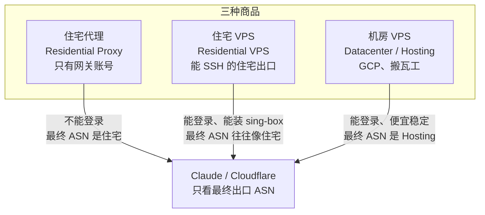

| | 住宅代理 | 住宅 VPS | 机房 VPS |
|---|---|---|---|
| 你买到的 | 一个出口身份 | 一台机器，并且这台机器的出口像住宅 | 一台机器 |
| 怎么用 | HTTP / SOCKS5 账号，连它的网关 | SSH 登录，自己装 sing-box 或其他服务 | SSH 登录，适合中转和常驻服务 |
| 能不能装软件 | 不能。没有壳，没有磁盘给你 | 能 | 能 |
| 最终出口 ASN | 住宅运营商 | 往往像住宅运营商，要以实测为准 | Hosting / 机房 |
| Claude 若直接从这里出去 | 看到的是家庭宽带 | 往往也能看到家庭宽带 | 常被嫌、易挑战 |
| 这次 | **用了。** RESIP 只负责最后一跳的身份 | **没买** | **用了已有的 GCP**，只做中转，不拿它的公网 IP 当 Claude 的身份 |

### 1.1 住宅代理：卖的是出口身份

住宅代理（Residential Proxy）不是服务器。供应商把出口放在住宅 ISP 的地址上，卖给你的是一组 HTTP / SOCKS5 网关账号。你不能 SSH 上去，不能在那头装 sing-box，也不能自己开端口。

它适合交给 AdsPower 或浏览器：这些程序本来就会填一个代理。它们需要的是「出去之后像一户美国家庭」，不是「有一台机器归我管」。

本次的 RESIP Pro 就是这一类：美区静态住宅，Dallas，住宅 ISP，协议是 HTTP / SOCKS5 网关。静态的意思是出口尽量固定在这一段住宅地址上，不是「每次拨号换一个动态地址」的那种池子。它仍然只是账号，不是 VPS。

### 1.2 住宅 VPS：机器和住宅 ASN 叠在同一个商品里

住宅 VPS（Residential VPS）是一台真的能登录的虚拟机，同时它的出口 ASN 往往挂在住宅运营商名下，而不是挂在托管商名下。因为你有 shell，可以在上面装 sing-box，让入站就开在这台机器上，目标站看到的源地址就是这个住宅 ASN。

听起来像把前两种并成一种。代价也叠在一起：

- **贵。** 家庭地址段不能像机房那样成批、稳定地租出去。同样是一小台能登录的机器，住宅 ASN 的租金通常明显高于机房同规格。本文不写一个具体标价，这类商品的牌价差得很开，下单前只看当时的购物车。
- **货源不稳。** 地址会被运营商收回、换段，供应商也会突然没货。它不适合当成「永远在线、上面跑着桌面 Claude 专线」的那台。
- **供应商参差。** 商品名写着 Residential VPS，不代表最终出口真是住宅 ASN。有的只是住宅代理外面套了一层面板。判断标准和 Claude 一样：看最终出口的 ASN 是住宅运营商还是 Hosting，不要看标题。`ip.net.coffee` 和 browserleaks 就是干这个的。

还有一条和「有没有机器」无关的限制：它若在境外，国内直连它上面的代理协议，同样会被 GFW 干扰。住宅 VPS 解决的是最终 ASN，不自动解决「从家里摸到它」。除非供应商标明支持国内直连，否则你还是要一台机房中转。那就变成机房 VPS 再加一台又贵又不稳的住宅 VPS，比「已有机房 VPS + 一个住宅代理账号」更重。

### 1.3 机房 VPS：便宜、稳定，适合中转，不适合当 Claude 的脸

机房 VPS（Datacenter / Hosting VPS）就是常见的 GCP、搬瓦工，以及同一类的其他托管商。你能 SSH，能装 sing-box，能放常驻服务，价格和供给都稳定。地址成段登记在托管商名下，ASN 类型是 Hosting。

它适合两件事：把流量安全送出大陆，以及跑长期不关机的服务（这里就是 Tailscale、`sing-box-ts`、桌面 Claude 的 `18080`）。它不适合当 Claude 看到的那张脸。线路再好、机器再大，ASN 还是机房。

### 1.4 Claude 看的是最终一跳，不是路径上有没有机器

目标站和前面的 Cloudflare 只看见连到他们的那个源地址。路径中间的机器，只要没有用自己的公网地址去连目标，就不会出现在对方的 ASN 检查里。

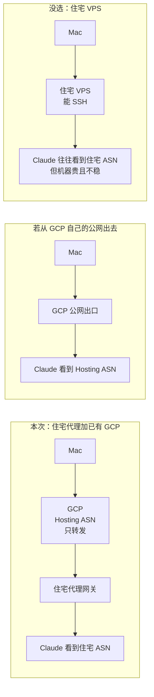

所以「我已经有一台 GCP」并不能让 Claude 高兴。桌面 Claude 现在走 `18080`，出去的就是这台 GCP 的公网地址，身份仍是机房。AdsPower 这条新链是把最后一跳换成住宅代理，Claude 在那个环境里看到的才是 Dallas 的住宅 ISP。

**本次不买住宅 VPS，就是因为这两件事已经拆开了：** 已有 GCP 上有 Tailscale、`18080` 和桌面 Claude，复用它做中转，边际成本是多一个 systemd 服务，不是再付一台机器的钱。住宅代理专门提供干净的出口身份。不必为了「既能登录、ASN 又像住宅」去买一份贵、货源不稳、供应商还参差的住宅 VPS。AdsPower 只需要一个 HTTP / SOCKS5 网关，不需要在住宅那头有 shell。

---

## 2. 为什么住宅代理在国内还要中转

RESIP 标注中国大陆需要中转。国内机器若直接去连境外代理协议，会被 GFW 干扰。住宅账号不能拿来当「从家里直连出去」的那一跳。

没有 VPS 时只剩两条路，本次都没走：

1. 换一个标明支持国内直连的住宅产品。
2. 用机场节点串住宅：机场负责出大陆，再链式转到住宅网关。多一跳，也多一套机场规则。

现在家里到 GCP 的 Tailscale 已经是通的，就用这台机器做中转。职责分开：

| 段 | 谁 | 它解决的问题 | ASN |
|---|---|---|---|
| Mac → Tailscale → GCP | 已有的机房 VPS | 安全出境 | 这一段的公网身份是 Hosting，但不拿它见 Claude |
| GCP → RESIP → 目标站 | 住宅代理 | 干净的美国家庭身份 | 目标站看到住宅 ISP |

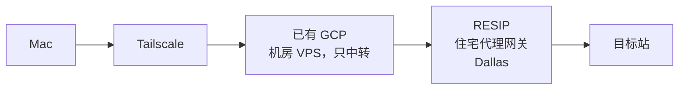

VPS 负责把流量平安送出大陆。住宅代理负责出了大陆之后长什么样。两边互相替代不了。

---

## 3. 总图：五步分别落在哪

下面这张图是实际接过的链路。带「步骤」的格子是这次动过的；写着「未改」的格子保持原样。对照时先找步骤号，再看它坐在哪一跳上。

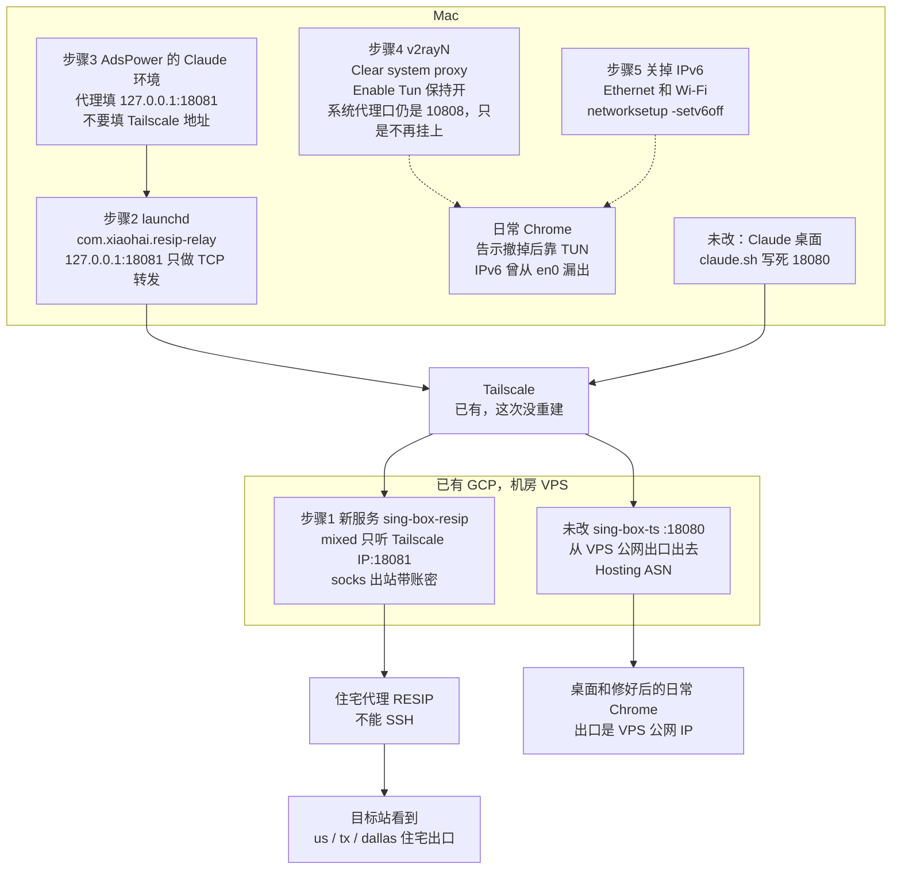

| 步骤 | 落在哪一格 | 做了什么 | 不要退回去做的事 |
|---|---|---|---|
| 1 | GCP 上的 `sing-box-resip` | 独立服务，配置在 `/etc/sing-box-resip/config.json`。mixed 入站只听 `<VPS的Tailscale IP>:18081`，socks 出站带账密连 RESIP | 没改 `18080`，没在住宅代理那头装软件（那里不能装） |
| 2 | Mac 的 `resip-relay.py` | `~/.local/bin/resip-relay.py`，launchd 名 `com.xiaohai.resip-relay`。`127.0.0.1:18081` 的 TCP 原样转到 VPS 的 Tailscale 地址 | 账密不放在 Mac。这层不解析 HTTP |
| 3 | AdsPower | 代理栏最终是 `127.0.0.1:18081` | 填过 `<VPS的Tailscale IP>:18081`，Check proxy 失败 |
| 4 | v2rayN | 底部改成 Clear system proxy，Enable Tun 保持开 | 系统代理还开着时，改成 `127.0.0.1` 也仍然不通 |
| 5 | Ethernet、Wi-Fi | `networksetup -setv6off` | 没改 v2rayN 的 IPv6 开关，也没改路由器 |

第 4 步和第 5 步不在「住宅数据包」那条实线上。它们改的是日常 Chrome 和 AdsPower 怎么选路。清掉系统代理之后，日常流量改靠 TUN；TUN 只接 IPv4，所以才有第 5 步。住宅环境自己走的是本机 `18081`，不靠那张系统代理告示。

---

## 4. 中转机器怎么选

中转问的是第 1 节里的「机房 VPS」，不是住宅身份。三个问题就够：

1. 要的是最终 ASN，还是一台能登录的机器？最终 ASN 去第 1 节，不要在这一节里找。
2. 从国内能不能稳定摸到这台机器？摸不到，住宅代理同样出不去。
3. 是新买一台，还是已经有一台在跑？

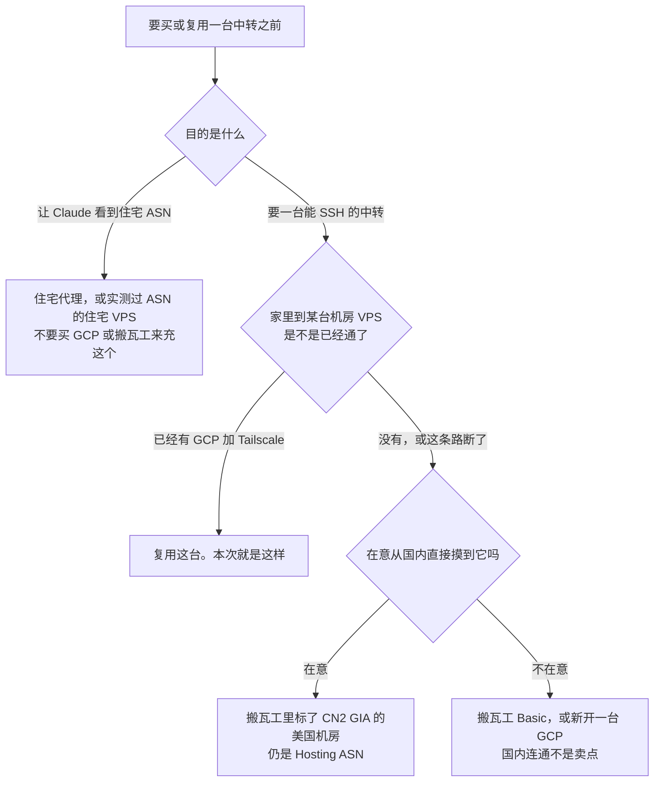

### 4.1 价格、美国节点、IP、国内连通

标价会变。搬瓦工下面的数字是 **2026-10-25** 从官网目录 [catalog.json](https://bandwagonhost.com/order/catalog.json) 读到的，单位是该账期的美元总价，不是月均。当时这些档有货。结账以购物车为准。

GCP 这次没有新开机器，所以没有「本次成交价」。从零买一台的公开目录价另注在表下，不要把它当成现有这台的账单。

| | 已有 GCP（本次中转） | 新开一台 GCP | 搬瓦工 Basic 20G | 搬瓦工 E-Commerce 20G，且机房说明里有 CN2 GIA |
|---|---|---|---|---|
| 你买到的 | 已经在付的那台机房 VPS | 另一台机房 VPS | 机房 VPS，KVM，能 SSH | 还是机房 VPS，KVM，能 SSH |
| 美国节点 | 现有这台在哪就用哪。本文不写项目名和区域 | 区域很多。免费档只认 us-west1、us-central1、us-east1 里的 e2-micro | 洛杉矶 USCA_2、弗里蒙特、纽约 USNY_6 等，可在 Basic 机房之间迁移 | 洛杉矶 USCA_6、USCA_9，圣何塞 USCA_SJC5，纽约 USNY_8。同价的 E-Commerce 也有不带 CN2 的机房，不能只看档名 |
| IP 干净度 | Hosting。桌面走 `18080` 时 Claude 看到的就是它 | 同样是 Google 的 Hosting 段 | Hosting。官方写明地址空间是自己的，仍然不是住宅 | Hosting。CN2 不改变 ASN 类型 |
| 对国内连通 | 不靠「GCP 对国内有优化线路」。靠已经建立的 Tailscale | Google 不卖 CN2。国内直连美国云主机经常不稳，还得再想办法把 Tailscale 或代理协议送出去 | 官网对 Basic 的说法是多数机房有本地对等，有的机房有成本向的中国对等。不是 CN2 GIA 产品 | 这些机房的说明写了电信 CN2 GIA、移动 CMIN2、联通 Premium。卖点是国内更容易摸到这台机器 |
| 公开标价 | 不加一台，就没有第二份机器租金 | 见下方目录价。磁盘、外部 IP、出流量另计 | **49.99 美元 / 年**。1 GB 内存，2 vCPU，20 GB 盘，每月 1 TB，1 Gbps | **49.99 美元 / 季，89.99 美元 / 半年，169.99 美元 / 年**。1 GB 内存，2 vCPU，20 GB 盘，每月 1 TB，2.5 Gbps |
| 适不适合当这次的中转 | **适合，而且已经在用** | 能当，但是重复买一条还没通的国内路径 | 能当一台便宜机器。不适合当成「为了国内连通才买」的那台 | 适合「手头还没有一条从家里走得通的中转」时新买。不适合本次 |

同一目录里还有洛杉矶 USCA_5 的 E-Commerce+SLA，20G 年付 239.99 美元（季付 65.89 美元），说明里同样有 CN2 GIA，还带 SLA。仍然是机房 IP。要的是保可用，不是要住宅身份时才看它。

从零开 GCP 的目录价（[economize.cloud 的 Compute Engine 表](https://www.economize.cloud/resources/gcp/pricing/compute-engine/e2-micro/)，us-central1，按需，2026-10-24，730 小时，不含税、不含磁盘、外部 IP 和出流量）：e2-micro 约 **6.11 美元 / 月**（0.0084 美元 / 小时），e2-small 约 **12.23 美元 / 月**。官方价目以 [VM instance pricing](https://cloud.google.com/products/compute/pricing) 为准。免费档见 [Google Cloud Free](https://cloud.google.com/free)：指定的三个美国区域里一台 e2-micro 的实例时长，加上有限的磁盘和很小的出流量额度。中转的出流量很容易超出免费额度，而且免费档不解决国内直连。不要为了「免费」再开一台来替代已经通的 Tailscale。

其他托管商（常见的按年小机房、大厂的 Lightsail 一类）都落在「机房 VPS」这一格。差别是标价，以及从国内能不能摸到，不是出口像不像家庭。本文不逐家抄价。

### 4.2 为什么是已有的 GCP，搬瓦工什么时候才更合适

本次中转用已有 GCP，因为 Tailscale、`18080`、桌面 Claude 已经在这台机器上。再买搬瓦工是第二台可登录的服务器，出口 ASN 仍然是 Hosting，住宅代理还是要另买。多出来的只是一份年费或季费，以及一套要重新装的系统。

搬瓦工更合适的时候只有这种：

- 手头没有已经能从家里走到的 VPS，或者这条 Tailscale 不能再依赖了。
- 你需要这台中转自己就能从国内比较稳定地摸到。这时买的是 **写了 CN2 GIA 的美国机房**（上面那四个），不是 Basic 的 49.99 美元年付。Basic 便宜，国内连通不是它的卖点。
- 买来只做中转盒子：上面装 sing-box，出站再接住宅代理。它替代的是 GCP 这一跳，替代不了 RESIP，更替代不了第 1 节里的住宅 VPS 决策。

IP 干不干净，不在这一节解决。搬瓦工和 GCP 交给 Claude 时，对方看到的都是机房。

---

## 5. 步骤 1 和 2：18081 怎么接

`18080` 是 `sing-box-ts`，流量从 GCP 自己的公网地址出去，桌面 Claude 还用它。住宅是旁边新开的独立服务。关掉住宅，不会把专线一起停掉。

| | 原来的专线 | 这次的住宅 |
|---|---|---|
| 机器 | 已有 GCP | 同一台 |
| systemd | `sing-box-ts` | `sing-box-resip.service` |
| 配置 | 原文件，没改 | `/etc/sing-box-resip/config.json` |
| 入站 | `18080` | mixed，只听 `<VPS的Tailscale IP>:18081` |
| 出站 | VPS 公网，Hosting ASN | socks，带账密去 RESIP，最终 ASN 是住宅 |
| 谁在用 | 桌面 Claude；修好 IPv6 之后，日常 Chrome 的 TUN 出口也是这台的公网 IP | 只有 AdsPower 的 Claude 环境 |

mixed 是 sing-box 的一种入站：同一个端口同时接受 HTTP 代理和 SOCKS。AdsPower 里协议选哪一种，都可以对着 `18081`。

它只听 Tailscale 地址，不听公网网卡。`18081` 从公网扫不到。账密只放在这台 VPS 的 socks 出站上。

下面是结构示意，不是线上文件原文。主机、端口、账密都是占位符；落地时 `server_port` 换成数字。

```json
{
  "inbounds": [
    {
      "type": "mixed",
      "tag": "resip-in",
      "listen": "<VPS的Tailscale IP>",
      "listen_port": 18081
    }
  ],
  "outbounds": [
    {
      "type": "socks",
      "tag": "resip-out",
      "server": "<RESIP网关主机>",
      "server_port": "<RESIP端口>",
      "version": "5",
      "username": "<RESIP用户名>",
      "password": "<RESIP密码>"
    }
  ]
}
```

Mac 上还要一层转发，是因为 AdsPower 应该连本机，而不是自己去找 Tailscale 地址。第 6 节就是填了 Tailscale 地址之后的失败。

`com.xiaohai.resip-relay` 跑 `~/.local/bin/resip-relay.py`：在 `127.0.0.1:18081` 接受 TCP，原样转到 `<VPS的Tailscale IP>:18081`。它不解析 HTTP，不看账密，只搬字节。HTTP 和 SOCKS 都是客户端先开口的 TCP，协议仍由 VPS 上的 mixed 入站来认。

AdsPower 里只填 `127.0.0.1:18081`。RESIP 的用户名和密码不出现在这里。

---

## 6. 接入过程的两个坑

住宅账号和中转机都对的时候，AdsPower 仍可能失败。这两坑都出在 Mac 怎么选路，不是出在「该不该买住宅 VPS」。

### 6.1 系统代理把环境代理链到了 v2ray 后面

环境刚建好时，代理栏填的是 `<VPS的Tailscale IP>:18081`。Check proxy 失败，打开浏览器是 Proxy failure。

日志在：

```text
~/Library/Application Support/adspower_global/cwd_global/log/
```

里面有一行：`[ProxyCheck] 系统代理：开`。

AdsPower 会去读系统代理。当时系统代理是 v2rayN 的 `127.0.0.1:10808`（和桌面专文里的本机 v2ray 口是同一个）。它于是在本地起一个 FORWARD_PROXY 端口，把**这个环境自己的代理串在系统代理后面**。

检测不是「AdsPower 直连你填的地址」。顺序是先服从 `10808`，再从那一侧去使用环境代理，然后才打开检测站。`check.adspower.com` 等三个检测域名全部 `host is unreachable`，5 秒超时。

把代理栏改成 `127.0.0.1:18081` 仍然不通。系统代理还开着，这个 `127.0.0.1` 是在链条后半段才被使用的。后半段已经离开了 Mac，`127.0.0.1` 指的是 VPS 自己。VPS 上并没有那个转发进程。

```mermaid
flowchart TB
  subgraph badTailscale [失败：填 Tailscale 地址，系统代理开着]
    A1["AdsPower"] --> P1["读到系统代理<br/>127.0.0.1:10808"]
    P1 --> F1["本地 FORWARD_PROXY<br/>环境代理链在系统代理后面"]
    F1 --> U1["check.adspower.com 等三个域名<br/>host is unreachable<br/>5 秒超时"]
  end
  subgraph badLoop [失败：改成 127.0.0.1:18081，系统代理仍开]
    A2["AdsPower"] --> P2["仍先进入 v2rayN"]
    P2 --> F2["127.0.0.1 跑到 VPS 那头去解析"]
    F2 --> U2["Mac 上的转发进程没被连上"]
  end
  subgraph ok [通过：步骤 3 加步骤 4]
    N["Clear system proxy<br/>Enable Tun 保持开"] --> A3["AdsPower 直连<br/>127.0.0.1:18081"]
    A3 --> R["resip-relay.py"]
    R --> V["VPS :18081 再到 RESIP"]
    V --> Done["Check proxy 通过<br/>us / tx / dallas 住宅出口"]
  end
```

前两次失败都不是 RESIP 账密错了，也不是 Tailscale 断了。

处理就三件，对应总图的步骤 3 和步骤 4：

1. v2rayN 底部改成 **Clear system proxy**。系统设置里不再挂着 `127.0.0.1:10808`。
2. **Enable Tun 保持开着。** 不要和系统代理一起关。
3. AdsPower 的代理栏保持 `127.0.0.1:18081`。

这时检测走本机转发，再到 VPS，再进住宅代理。Check proxy 通过，显示 us / tx / dallas 住宅出口。

### 6.2 系统代理是告示，TUN 是一块网卡

**系统代理**是写给软件看的告示：「请把流量交给 `127.0.0.1:10808`」。浏览器这类会读告示的程序才照做。不读的程序仍从原来的网卡出去。告示本身不挡包。

**TUN** 是 v2rayN 的一块虚拟网卡。包在网络层就被截走，应用不用去读告示。

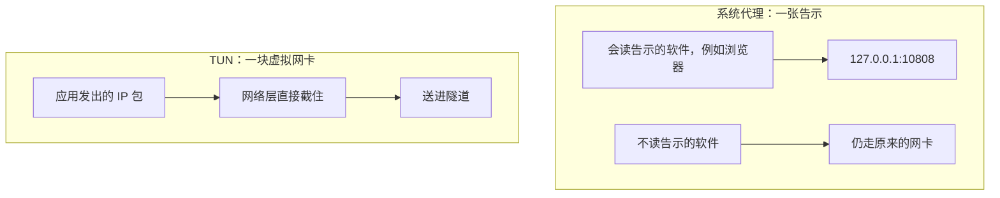

系统代理已经清掉的前提下，用 Google 就能把两层分开：Enable Tun 关着，Google 打不开，因为告示没了，也没有网卡在截；Enable Tun 开着，Google 能打开，靠的是虚拟网卡。

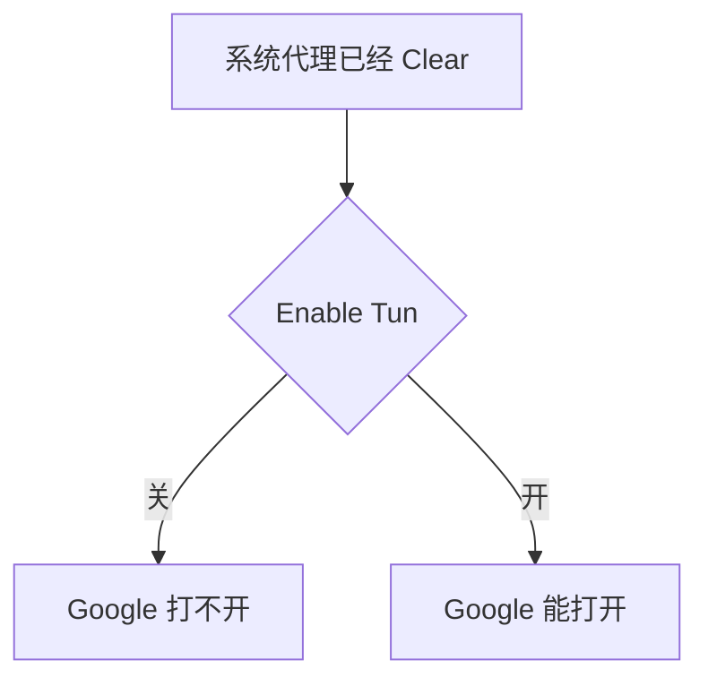

为了让 AdsPower 直连 `127.0.0.1:18081`，告示必须撤掉。日常 Chrome 从此改靠 TUN。下一小节就是这张网卡只盖住了 IPv4。

### 6.3 IPv6 不进 TUN，从 en0 漏回国内

系统代理清掉之后，用日常 Chrome 打开 `ip.net.coffee/claude`。Claude 那一栏是国内电信的 IPv6，归属安徽宣城，AS4134，信任分 0，`claude.ai` 打不开。

AdsPower 的 Check proxy 当时已经是 dallas。两个结果不矛盾：AdsPower 的最终出口是住宅代理；日常 Chrome 这次没走 `18081`。

v2rayN 的 TUN 只接管 IPv4。IPv6 的默认路由还在 `en0` 上，也就是 Ethernet 或 Wi-Fi。`claude.ai` 有 IPv6，浏览器优先用 IPv6。这些包不进 TUN，顺着物理网卡从运营商出去。

以前看不出来，是因为系统代理还开着。浏览器把连接交给 `127.0.0.1:10808`，自己不去对 `claude.ai` 做 IPv6 连接。告示一撤，浏览器恢复自己选路，IPv6 就漏出来了。

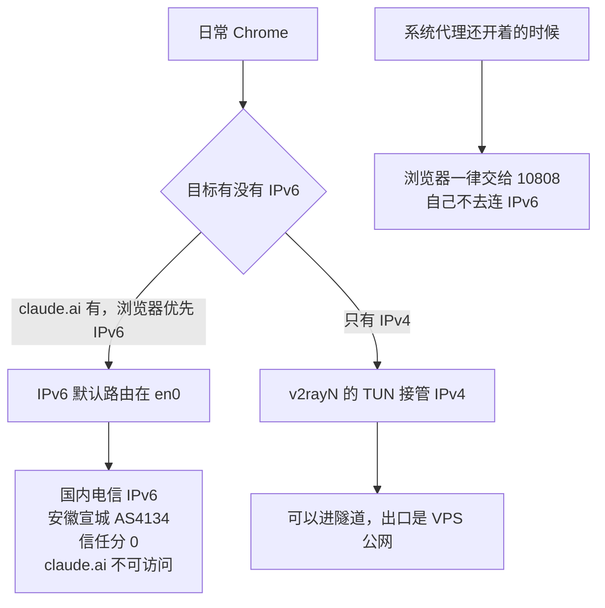

检测页上还有一张「中国出口 IPv4」的卡，上面是电信的 IPv4。这张卡是正常的。路由规则选了「绕过大陆」：访问国内地址的 IPv4 本来就不进隧道。不能拿它判断住宅代理或 VPS 出口坏了。要看的是 Claude 那一栏有没有变成国内 IPv6。

这次的处理是不让 Ethernet 和 Wi-Fi 再配置 IPv6。浏览器没有 IPv6 可选，只剩 IPv4，才能进 TUN。

```bash
networksetup -setv6off "Ethernet"
networksetup -setv6off "Wi-Fi"
```

然后两条命令的结果都应是 VPS 美国出口 `<VPS公网IP>`，不是刚才那个国内 IPv6，也不是 `<住宅出口IP>`。日常 Chrome 修好之后走的是 TUN 的既有出口，也就是这台 GCP 的公网，不是 AdsPower 的住宅链。

```bash
curl -6 --max-time 15 https://api64.ipify.org
echo
curl -sS --max-time 15 https://api64.ipify.org
echo
```

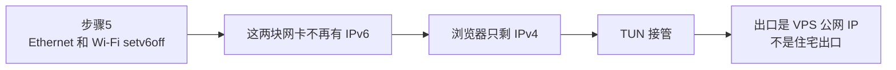

恢复时对同一对服务名改回 automatic：

```bash
networksetup -setv6automatic "Ethernet"
networksetup -setv6automatic "Wi-Fi"
```

只要 TUN 仍不接管 IPv6，恢复之后 `claude.ai` 会再次优先走 `en0`。

另外两种堵法这次没做，留在这里：

| 办法 | 改的是哪一层 | 和这次的差别 |
|---|---|---|
| v2rayN 的 TUN 里开启 IPv6 接管 | 虚拟网卡开始接 IPv6 默认路由 | 本机可以继续有 IPv6，包进隧道，而不是从 `en0` 直出 |
| 在路由器上关 IPv6 | 局域网分不到公网 IPv6 | 同一网络里的其他设备一起生效 |

之后用 `ip.net.coffee` 和 browserleaks 再看。Claude 栏不应再出现国内电信 IPv6。「中国出口 IPv4」那张卡继续显示电信地址，对应绕过大陆。

---

## 7. 桌面 Claude 仍走 18080

日常 Chrome、AdsPower、桌面 Claude 是三条路。

桌面的 `claude.sh` 把 `--proxy-server` 写死在 `18080`。那是 `sing-box-ts` 的 VPS 公网出口，Hosting ASN，不读刚刚清掉的系统代理，也不走 `18081`。守护脚本 fail-closed，只认 VPS 的出口 IP `<VPS公网IP>`。出口不是这个地址，它就不把这条路当成正常。

所以清系统代理、开着 TUN、关掉 IPv6，都没有把桌面改到住宅出口上。桌面现在给 Claude 看的仍然是机房 IP。这是有意留着的，不是漏改。

以后若要桌面也用住宅，目标是 `127.0.0.1:18081`。必须同时改 `claude.sh` 和守护脚本。只改启动参数的话，出口会变成住宅 IP `<住宅出口IP>`，守护脚本仍只认 `<VPS公网IP>`，会判失败。这次没有改。

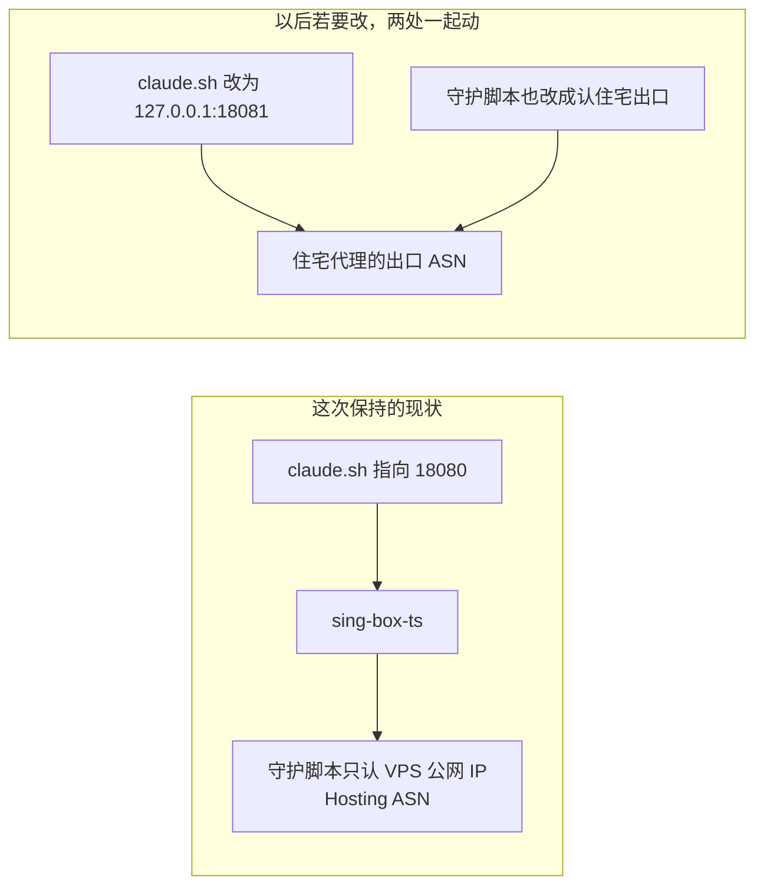

---

## 8. 什么时候把住宅挂进 v2ray，以及怎么撤

可以在这台 GCP 上再加一个 VLESS 之类的入站，出站仍接 RESIP，然后在 v2rayN 里当成一个节点。技术上通。那样日常软件的最终出口也会变成住宅 ASN。

不建议拿来做全局，原因就两个：

- 这个住宅代理每月 50GB。全局之后，日常网页都算进这 50GB。
- 那些站点都会顶着同一个干净的家庭 IP 出现。身份会被日常流量用脏。

住宅代理只给 AdsPower 里的 Claude 环境。该环境这么设：

| 项 | 怎么设 |
|---|---|
| 代理 | `127.0.0.1:18081`。系统代理保持清掉，TUN 保持开 |
| 时区 | `America/Chicago` |
| WebRTC | 禁用，或 Proxy UDP。WebRTC 可以不经过你填的 HTTP / SOCKS 去探地址 |
| 和其他线路 | 跟台湾 Bybit 线路分开，不要填进同一个环境 |
| 多个账号 | 一个账号一个 AdsPower 环境 |

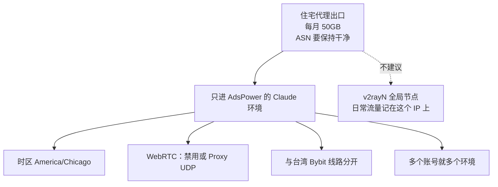

真要全局住宅出口，先回到第 1 节：那是在消耗住宅代理的流量和名声，不是去买一台住宅 VPS 的理由。只有「必须在住宅 ASN 那头自己装软件」时，住宅 VPS 才进入候选，并且还要单独解决国内能不能摸到它。

### 8.1 回滚

只撤住宅这一跳。`18080` 和 `claude.sh` 不要跟着动。IPv6 是否恢复是另一件事：TUN 仍然不管 IPv6 时，把 IPv6 开回去，日常 Chrome 会再漏出国内电信地址。

VPS 上停掉新服务：

```bash
sudo systemctl disable --now sing-box-resip
```

确认不再需要之后，再删 unit 文件和配置目录。unit 不在下面这个路径的话，删实际启用的那一份：

```bash
sudo rm -f /etc/systemd/system/sing-box-resip.service
sudo rm -rf /etc/sing-box-resip
sudo systemctl daemon-reload
```

Mac 上卸掉转发。plist 若是从别的路径加载的，删实际那一份：

```bash
launchctl bootout gui/$(id -u)/com.xiaohai.resip-relay
rm -f ~/Library/LaunchAgents/com.xiaohai.resip-relay.plist
rm -f ~/.local/bin/resip-relay.py
```

AdsPower 里这个环境的代理栏也清掉，避免它还去连已经不存在的 `127.0.0.1:18081`。

---

## 9. 下次先对总图，再动手

1. 分不清该买什么时，回到第 1 节。要身份就看最终 ASN；要中转就看第 4 节。不要买住宅 VPS 来替代已经在用的 GCP，也不要买搬瓦工来获得住宅身份。
2. AdsPower 失败时先看日志是不是 `系统代理：开`。是的话不要先改 RESIP 账密。
3. 代理栏应是 `127.0.0.1:18081`。系统代理还开着时，填 Tailscale 地址或填本机回环，都会不通。
4. v2rayN：Clear system proxy，Enable Tun 开着。再 Check proxy，应看到 us / tx / dallas。
5. 日常 Chrome 打开 `ip.net.coffee/claude`。Claude 栏若是安徽宣城的电信 IPv6、信任分 0，就是第 6.3 节，不是住宅账号失效。
6. `setv6off` 之后，`curl -6` 和 `curl https://api64.ipify.org` 都应是 `<VPS公网IP>`。这是机房出口，不是住宅出口。
7. 「中国出口 IPv4」卡上的电信地址保持原样，对应「绕过大陆」。
8. 桌面 Claude 仍由 `claude.sh` 指向 `18080`。要改去 `18081` 时，连守护脚本一起改。

- [ ] 说得清三样东西：住宅代理不能登录，住宅 VPS 能登录且 ASN 往往像住宅但本次没买，GCP / 搬瓦工是机房 ASN
- [ ] 中转仍是已有 GCP；`sing-box-resip` 在跑；`18080` 没被改
- [ ] mixed 只听 `<VPS的Tailscale IP>:18081`；账密只在 VPS 的 socks 出站
- [ ] Mac 上 `com.xiaohai.resip-relay` 把 `127.0.0.1:18081` 转到上述地址
- [ ] v2rayN 是 Clear system proxy，Enable Tun 开着
- [ ] AdsPower 代理栏是 `127.0.0.1:18081`，Check proxy 为 us / tx / dallas
- [ ] Ethernet 与 Wi-Fi 已 `setv6off`；两条 curl 都是 `<VPS公网IP>`
- [ ] `ip.net.coffee/claude` 不再是国内电信 IPv6；browserleaks 再对过一次
- [ ] 桌面仍走 `18080`；住宅没有做成 v2rayN 的全局节点
- [ ] AdsPower 的 Claude 环境：时区 `America/Chicago`，WebRTC 为禁用或 Proxy UDP，与台湾 Bybit 线路分开

---

## 10. 延伸阅读

- [Claude 专线全记录](./claude-wireguard-vpn.md) — 这台 GCP 上的 Tailscale 和 `sing-box-ts` 的 `18080`
- [Claude 桌面版 Try again](./claude-desktop-try-again.md) — 桌面为什么写死 `--proxy-server`，以及 `10808` 那张告示曾经怎么漏进壳层
- [搬瓦工官网目录](https://bandwagonhost.com/order/catalog.json) — 第 4 节的标价来源，结账前再看一眼有没有货
- [Google Cloud VM 标价](https://cloud.google.com/products/compute/pricing) 与 [Free Tier](https://cloud.google.com/free) — 只有从零新开 GCP 时才需要

---

*记录于 2026-10-25。地址一律用 `<VPS的Tailscale IP>`、`<VPS公网IP>`、`<住宅出口IP>` 占位。端口只写 `10808`、`18080`、`18081`。不写 GCP 项目名，不写 RESIP 的主机名和账密。搬瓦工价格来自当天的官网目录，GCP 从零购买的月费来自 2026-10-24 的公开目录价，都不是本次账单。*
